<h1>
IF2150 REKAYASA PERANGKAT LUNAK
<br>
TUGAS 10
<br>
HASIL IMPLEMENTASI DAN UJI PERANGKAT LUNAK (HIUPL)
</h1>
<br>

## *SaveBite*


### Untuk: *Aurelia Jennifer Gunawan*

Dipersiapkan oleh:
| Informasi | Keterangan |
| --- | --- |
| Kelas | *K02* |
| Kelompok | *G06*  |

| NIM | Nama |
|---|---|
| *13525122* | *Nadia Aulia Syafarani* |
| *13525041* | *Renata Puspanegara Ninagan* |
| *13525119* | *Ghina Emelia Yantes* |
| *13525017* | *Cendra Asih Chairunnisa* |
| *13525089* | *Sherin Felicia Danessa* |

---

## Daftar Isi

- [BAB 1: Pendahuluan](#bab-1-pendahuluan)
  - [1.1 Tujuan Penulisan Dokumen](#11-tujuan-penulisan-dokumen)
  - [1.2 Lingkup Masalah](#12-lingkup-masalah)
  - [1.3 Definisi, Istilah, dan Singkatan](#13-definisi-istilah-dan-singkatan)
  - [1.4 Aturan Penomoran](#14-aturan-penomoran)
  - [1.5 Referensi](#15-referensi)
  - [1.6 Deskripsi Umum Dokumen (Ikhtisar)](#16-deskripsi-umum-dokumen-ikhtisar)
- [BAB 2: Deskripsi Umum Perangkat Lunak](#bab-2-deskripsi-umum-perangkat-lunak)
- [BAB 3: Implementasi](#bab-3-implementasi)
  - [3.1 Lingkungan Implementasi](#31-lingkungan-implementasi)
  - [3.2 Implementasi Modul](#32-implementasi-modul)
  - [3.3 Implementasi Antarmuka](#33-implementasi-antarmuka)
  - [3.4 File Lain](#34-file-lain)
- [BAB 4: Hasil Pengujian](#bab-4-hasil-pengujian)
  - [4.1 Strategi dan Kedalaman Pengujian Kelas](#41-strategi-dan-kedalaman-pengujian-kelas)
  - [4.2 Pengujian Unit Kelas](#42-pengujian-unit-kelas)
  - [4.3 Pengujian Integrasi](#43-pengujian-integrasi)
  - [4.4 Pengujian Use Case](#44-pengujian-use-case)
  - [4.5 Pengujian Kebutuhan Non-Fungsional (KNF)](#45-pengujian-kebutuhan-non-fungsional-knf)
  - [4.6 Tangkapan Layar dan Bukti Hasil Pengujian](#46-tangkapan-layar-dan-bukti-hasil-pengujian)
- [BAB 5: Traceability](#bab-5-traceability)

---

## Daftar Perubahan

| Revisi | Deskripsi |
| :--- | :--- |
| *A* | *Dokumen HIUPL disusun berdasarkan SKPL, APL, DPPL2, dan laporan Implementasi M9; hasil implementasi dan pengujian aktual ditambahkan.* |
| *B* |  |
| *C* |  |
| ... |  |

---

# BAB 1: Pendahuluan

## 1.1 Tujuan Penulisan Dokumen
Dokumen Hasil Implementasi dan Uji Perangkat Lunak (HIUPL) SaveBite menjelaskan lingkungan dan realisasi implementasi, hasil pengujian unit, integrasi, use case, dan kebutuhan non-fungsional, serta pemetaan kebutuhan terhadap kode dan bukti uji. Dokumen ini ditujukan bagi dosen/asisten dan anggota kelompok sebagai bahan evaluasi serta acuan pemeliharaan perangkat lunak.

## 1.2 Lingkup Masalah
SaveBite adalah aplikasi web untuk mempertemukan penjual makanan surplus dengan pembeli melalui pengelolaan listing, katalog dan pencarian, keranjang, checkout dengan QRIS dummy, serta reward login berupa kupon; aplikasi berjalan pada frontend Next.js dan backend FastAPI dengan basis data SQLite lokal, tanpa integrasi ke payment gateway eksternal.

## 1.3 Definisi, Istilah, dan Singkatan

Tabel 1.3. Definisi Istilah dan Singkatan

| Singkatan, Akronim, atau Istilah | Penjelasan |
| :--- | :--- |
| *P/L* | *Singkatan dari Perangkat Lunak, yaitu aplikasi yang memberikan perintah kepada komputer untuk menjalankan tugas tertentu.* |
| *SKPL* | *Singkatan dari Spesifikasi Kebutuhan Perangkat Lunak, yaitu dokumen yang merangkum kriteria-kriteria yang diperlukan untuk membangun aplikasi menjalankan tugasnya.* |
| *DPPL* | *Singkatan dari Deskripsi Perancangan Perangkat Lunak, yaitu dokumen yang menjelaskan rancangan arsitektur, kelas, dan antarmuka P/L.* |
| *HIUPL* | *Singkatan dari Hasil Implementasi dan Uji Perangkat Lunak, yaitu dokumen yang melaporkan hasil implementasi dan pengujian P/L.* |
| *KF* | *Singkatan dari Kebutuhan Fungsional.* |
| *KNF* | *Singkatan dari Kebutuhan Non-Fungsional.* |
| *UC* | *Singkatan dari Use Case.* |
| *TC* | *Singkatan dari Test Case, yaitu satu kasus uji untuk skenario tertentu.* |
| *UT* | *Singkatan dari Unit Test, yaitu test case tingkat kelas/operasi.* |
| *INT* | *Singkatan dari Integration Test, yaitu test case yang menguji interaksi antarkomponen.* |
| *Boundary* | *Kasus uji pada nilai batas masukan, misalnya nilai minimum, maksimum, atau tepat di ambang aturan.* |
| *Coverage* | *Persentase baris/cabang kode yang dieksekusi oleh pengujian.* |
| *SQLite* | *DBMS relasional berbasis berkas yang dipakai aplikasi pada implementasi M9.* |
| *E2E* | *End-to-end, pengujian alur aplikasi dari antarmuka sampai layanan backend.* |

## 1.4 Aturan Penomoran

Tabel 1.4. Aturan Penomoran

| Hal/Bagian | Penomoran | Keterangan |
| :--- | :--- | :--- |
| *Kebutuhan Fungsional* | *KFXX* | *Sesuai SKPL* |
| *Kebutuhan Non-Fungsional* | *KNFXX* | *Sesuai SKPL* |
| *Use Case* | *UCXX* | *Sesuai SKPL* |
| *Kelas* | *CXX* | *Sesuai DPPL* |
| *Antarmuka* | *I-XX* | *Sesuai DPPL* |
| *Test Case Unit* | *CXX-UTYY* | *XX adalah nomor kelas, YY adalah nomor urut test case unit pada kelas tersebut* |
| *Test Case Integrasi* | *INT-TCYY* | *YY adalah nomor urut test case integrasi* |
| *Test Case Use Case* | *UCXX-TCYY* | *XX adalah nomor use case, YY adalah nomor urut test case pada use case tersebut* |
| *Test Case KNF* | *KNFXX-TCYY* | *XX adalah nomor KNF, YY adalah nomor urut test case KNF tersebut* |

## 1.5 Referensi
- K02_G06_SKPL, Tugas 5, `docs/M5/K02_G06_SKPL.md`.
- K02_G06_APL, Tugas 6, `docs/M6/K02_G06_APL.md`.
- K02_G06_DPPL2, Tugas 8, `docs/M8/K02_G06_DPPL2.md`.
- K02_G06_Implementasi, Tugas 9, `docs/M9/K02_G06_Implementasi.md`.
- FastAPI, Python `pytest`, `pytest-cov`, Playwright, Next.js, React, dan SQLite; versi implementasi dicatat pada Subbab 3.1.

## 1.6 Deskripsi Umum Dokumen (Ikhtisar)
Bab 1 menjelaskan tujuan, lingkup, istilah, penomoran, dan referensi. Bab 2 memberi gambaran sistem. Bab 3 mencatat lingkungan serta modul, antarmuka, dan file implementasi. Bab 4 melaporkan strategi dan hasil pengujian unit, integrasi, use case, dan KNF berikut buktinya. Bab 5 memetakan kebutuhan fungsional dan non-fungsional ke implementasi dan pengujian.

<br>

---

# BAB 2: Deskripsi Umum Perangkat Lunak

SaveBite merupakan aplikasi web untuk jual-beli makanan surplus. Pembeli menggunakan katalog, pencarian dan filter harga, detail listing, keranjang, pembayaran QRIS dummy, serta reward login. Penjual mengelola listing dan pesanan. Frontend Next.js mengakses backend FastAPI dan data disimpan di SQLite. Tidak ada payment gateway eksternal yang terhubung. Diagram use case berikut merujuk SKPL M5.

<p align="center">

</p>
<p align="center">
<i>Gambar 2.1. Use Case Diagram SaveBite (sumber: SKPL M5)</i>
</p>

<br>

---

# BAB 3: Implementasi

Bab ini mencatat elemen P/L yang dikembangkan, yaitu *source file*, *configuration file*, dan *data file*, beserta perubahannya terhadap rancangan DPPL. Rincian perubahan per kelas dan per layar mengacu pada Tabel B.1 laporan Implementasi (M9).

## 3.1 Lingkungan Implementasi

Lingkungan implementasi berbeda dari Subbab 2.1 DPPL pada tiga hal (Tabel B.1 no. 1 laporan M9):
1. **DBMS** diganti dari PostgreSQL 15 menjadi SQLite (modul `sqlite3` bawaan Python), supaya aplikasi bisa dijalankan lokal tanpa memasang server basis data. Penguncian baris `SELECT ... FOR UPDATE` diganti `BEGIN IMMEDIATE` dan `UPDATE` bersyarat.
2. **Python** naik dari 3.11 ke 3.12, sesuai CI (`.github/workflows/ci.yml`). Bukti pengujian M10 dijalankan di Python 3.13.7 dan diverifikasi ulang di Python 3.15.2. Kode memakai sintaks `X | Y`, jadi Python yang didukung adalah ≥ 3.10.
3. **Node.js** naik dari v20 ke 22, dengan Next.js 16.4.4 dan React 19.3.0.

Tabel 3.1. Lingkungan Implementasi

| Aspek | Keterangan |
| :--- | :--- |
| *Hardware* | *Laptop pengembangan anggota kelompok. Mesin bukti uji utama: AMD Ryzen 7 260 (8 core), RAM 16 GB, SSD 1 TB. Verifikasi ulang: laptop macOS (Apple Silicon).* |
| *Operating System* | *Windows 11 (mesin bukti pytest dan Playwright M10). macOS 27 (verifikasi ulang coverage per kelas). Aplikasi diakses lewat browser modern; E2E memakai Chromium headless.* |
| *Bahasa Pemrograman* | *Python 3.12 (target CI; bukti uji di Python 3.13.7 dan 3.15.2), TypeScript 5, SQL (dialek SQLite).* |
| *Framework/Library* | *Backend: FastAPI ≥ 0.110, Uvicorn ≥ 0.28, Pydantic ≥ 2.6, bcrypt 4.1.2, qrcode[pil] ≥ 7.4, python-multipart. Frontend: Next.js 16.4.4 (App Router, Turbopack), React 19.3.0, Tailwind CSS 4, @fontsource/line-seed-jp.* |
| *DBMS* | *SQLite 3 melalui modul `sqlite3` bawaan Python. Satu berkas `src/savebite.db` yang dibuat otomatis oleh `init_db()`.* |
| *Development Tools* | *Visual Studio Code, Git dan GitHub (branch per fitur, Pull Request ke `Development`), GitHub Actions (CI), npm, draw.io/PlantUML (diagram).* |
| *Testing Tools* | *pytest ≥ 8.0, pytest-cov/coverage.py (coverage baris dan cabang, laporan per kelas/fungsi), FastAPI `TestClient`/httpx (pengujian integrasi), Playwright 1.64.1 + Chromium (E2E), `cProfile` dan `time.perf_counter` (profiling M9), inspeksi SQLite (KNF02).* |

## 3.2 Implementasi Modul

ID dan nama kelas sama dengan DPPL, dan lokasi file konsisten dengan Tabel B.5 laporan M9. Aplikasi berupa aplikasi web yang diinterpretasi (Python) dan di-*bundle* (Next.js), sehingga tidak ada *executable* per kelas. Backend dijalankan dengan `uvicorn backend.main:app`, frontend dengan `npm run dev` atau `npm run build && npm start`.

Tabel 3.2. Implementasi Modul

| No | ID Kelas | Nama Modul/Kelas | Nama File Fisik | Nama File Executable |
| :--- | :--- | :--- | :--- | :--- |
| 1 | C01 | Pengguna | `src/backend/models.py` (`Pengguna`); verifikasi password di `src/backend/routers/auth.py` | - |
| 2 | C02 | Penjual | `src/backend/models.py` (`Penjual`); `src/backend/api/toko_routes.py` | - |
| 3 | C03 | Pembeli | `src/backend/models.py` (`Pembeli`) | - |
| 4 | C04 | ListingMakanan | `src/backend/models.py` (`ListingMakanan`) | - |
| 5 | C05 | MetodePembayaran | `src/backend/adapters/metode_pembayaran.py` | - |
| 6 | C06 | Transaksi | `src/backend/models.py` (`Transaksi`); operasinya dijalankan di `src/backend/controllers/pembayaran_controller.py` | - |
| 7 | C07 | RewardLogin | `src/backend/models.py` (`RewardLogin`) | - |
| 8 | C08 | ItemTransaksi | `src/backend/models.py` (`ItemTransaksi`) | - |
| 9 | C09 | Kupon | `src/backend/models.py` (`Kupon`) | - |
| 10 | C10 | LoginView | `src/frontend/app/login/page.tsx`; `src/frontend/middleware.ts` | Bundle Next.js (`.next/`) |
| 11 | C11 | KatalogView | `src/frontend/app/katalog/page.tsx`; `src/frontend/app/katalog/[id]/page.tsx`; `src/frontend/components/katalog/` | Bundle Next.js (`.next/`) |
| 12 | C12 | ListingView | `src/frontend/app/penjual/listing/` (`page.tsx`, `tambah/page.tsx`, `[id]/edit/page.tsx`); `src/frontend/components/penjual/` | Bundle Next.js (`.next/`) |
| 13 | C13 | PembayaranView | `src/frontend/app/cart/page.tsx`; `src/frontend/lib/cart.tsx`; `src/frontend/app/pembayaran/[idTransaksi]/page.tsx` | Bundle Next.js (`.next/`) |
| 14 | C14 | RewardView | `src/frontend/app/reward/page.tsx` | Bundle Next.js (`.next/`) |
| 15 | C15 | AuthController | `src/backend/routers/auth.py` | - |
| 16 | C16 | KatalogController | `src/backend/controllers/katalog_controller.py`; `src/backend/schemas/katalog.py` | - |
| 17 | C17 | ListingController | `src/backend/api/listing_routes.py`; `src/backend/services/listing_service.py` | - |
| 18 | C18 | PembayaranController | `src/backend/controllers/pembayaran_controller.py`; `src/backend/api/pembayaran_routes.py`; `src/backend/schemas/pembayaran.py` | - |
| 19 | C19 | RewardController | `src/backend/controllers/reward_controller.py`; `src/backend/schemas/reward.py` | - |
| 20 | C20 | Validasi | `src/backend/validation.py`; `src/backend/schemas/listing_schema.py` | - |
| 21 | C21 | PaymentGatewayAdapter | `src/backend/adapters/payment_gateway_adapter.py` | - |

## 3.3 Implementasi Antarmuka

ID layar mengikuti Subbab 6.1 DPPL2.

Tabel 3.3. Implementasi Antarmuka

| No | ID Antarmuka | Nama Antarmuka | Nama File Fisik | Nama File Executable |
| :--- | :--- | :--- | :--- | :--- |
| 1 | UI-01 | Sign Up | **Tidak diimplementasikan.** Akun dibuat oleh `src/backend/seed.py` karena SKPL tidak memiliki use case pendaftaran (Tabel B.1 no. 12 M9) | - |
| 2 | UI-02 | Log In | `src/frontend/app/login/page.tsx` | Bundle Next.js (`.next/`) |
| 3 | UI-03 | Home (Today's Menu / Katalog) | `src/frontend/app/katalog/page.tsx`; `src/frontend/components/katalog/` | Bundle Next.js (`.next/`) |
| 4 | UI-04 | My Reward | `src/frontend/app/reward/page.tsx` | Bundle Next.js (`.next/`) |
| 5 | UI-05 | My Cart dan Payment | `src/frontend/app/cart/page.tsx`; `src/frontend/app/pembayaran/[idTransaksi]/page.tsx`; `src/frontend/app/pembayaran/scan/[token]/page.tsx` | Bundle Next.js (`.next/`) |
| 6 | UI-06 | Add Product / Edit Product / Manage Listings | `src/frontend/app/penjual/listing/page.tsx`; `src/frontend/app/penjual/listing/tambah/page.tsx`; `src/frontend/app/penjual/listing/[id]/edit/page.tsx` | Bundle Next.js (`.next/`) |
| 7 | UI-07 | Detail Produk | `src/frontend/app/katalog/[id]/page.tsx`; `src/frontend/components/katalog/DetailListing` | Bundle Next.js (`.next/`) |
| 8 | Tambahan | Dashboard Penjual dan Profil Toko | `src/frontend/app/penjual/page.tsx`; `src/frontend/app/penjual/account/page.tsx` | Bundle Next.js (`.next/`) |

## 3.4 File Lain

Tabel 3.4. File Lain

| No | Nama File | Keterangan |
| :--- | :--- | :--- |
| 1 | `src/backend/main.py` | Titik masuk FastAPI: registrasi router, CORS, dan penyajian folder `uploads/`. |
| 2 | `src/backend/models.py` (`init_db()`) | Skema basis data SQLite dan migrasi ringan yang dijalankan setiap backend menyala. |
| 3 | `src/backend/seed.py` | Data uji: 4 akun, 12 listing contoh, dan 3 listing skenario alternatif (stok habis, kedaluwarsa, nonaktif). |
| 4 | `src/savebite.db` | Berkas basis data SQLite lokal. |
| 5 | `src/backend/errors.py` | Kelas `PembayaranError` untuk kesalahan domain pembayaran. |
| 6 | `src/backend/api/penjualan_routes.py`, `src/backend/api/routes.py` | Route pesanan masuk Penjual dan agregasi router API. |
| 7 | `src/backend/uploads/listing/` | Penyimpanan foto listing (PNG/JPG, maks. 10 MB). |
| 8 | `src/backend/requirements.txt`, `src/backend/pytest.ini` | Dependensi backend dan konfigurasi pytest. |
| 9 | `src/backend/tests/` (14 berkas + `conftest.py`) | Suite pytest unit dan integrasi (132 test). |
| 10 | `src/frontend/package.json`, `package-lock.json` | Skrip dan dependensi frontend yang dikunci. |
| 11 | `src/frontend/next.config.ts` | *Rewrite* `/api/*` ke backend `:8000` supaya cookie sesi *same-origin*. |
| 12 | `src/frontend/lib/api.ts`, `src/frontend/constants/` | Klien API dan konstanta antarmuka. |
| 13 | `src/frontend/tests/e2e/`, `src/frontend/playwright.config.ts` | Suite Playwright (4 berkas, 6 test) dan konfigurasinya. |
| 14 | `src/.env.example` | Contoh environment variable opsional (`SAVEBITE_PUBLIC_WEB_URL`, `NEXT_PUBLIC_API_URL`). |
| 15 | `.github/workflows/ci.yml` | CI: pytest, Playwright, lint, dan build pada setiap push/PR ke `Development`. |

<br>

---

# BAB 4: Hasil Pengujian

Bab ini melaporkan hasil pengujian P/L pada level unit, integrasi, dan sistem. Pengujian dilakukan pada tag release terakhir Tugas 9, yaitu **`v9.0`**. Kode `src/` pada commit dokumen ini identik dengan `v9.0`; perbedaannya hanya pada `src/README.md`. Hasil aktual diisi berdasarkan pengamatan saat pengujian. Kesimpulan diisi `Pass` atau `Fail`, dan untuk `Fail` dilengkapi penyebab serta usulan perbaikan.

## 4.1 Strategi dan Kedalaman Pengujian Kelas

Seluruh kelas pada Tabel 5.1 DPPL2 diklasifikasikan ke tiga tingkat kedalaman pengujian:
- **Mendalam**: kelas yang memuat logika bisnis, perhitungan, validasi, aturan status, atau keamanan.
- **Sedang**: kelas yang hanya mengoordinasikan atau mendelegasikan proses.
- **Tidak perlu**: kelas tanpa logika saat runtime. Kelas ini teruji tidak langsung melalui test case use case.

Tabel 4.1.1. Identifikasi Tingkat Pengujian Kelas

| ID Kelas | Nama Kelas | Tingkat | Alasan | Test Case Terkait |
| :--- | :--- | :--- | :--- | :--- |
| C01 | Pengguna | Tidak perlu | Pada implementasi kelas tidak dibuat objeknya. Verifikasi password (`bcrypt.checkpw`) dan penentuan peran dijalankan di AuthController (Tabel B.1 no. 2 M9), sehingga logikanya diuji pada C15. | C15-UT01 s.d. C15-UT06, UC07-TC01, UC07-TC02 |
| C02 | Penjual | Tidak perlu | Data toko saja. Kepemilikan listing diperiksa pada query ListingController. | C17-UT07, UC01, UC06, UC09 |
| C03 | Pembeli | Tidak perlu | Data akun saja, tanpa operasi. | UC02 s.d. UC05, UC08 |
| C04 | ListingMakanan | Mendalam | Memuat aturan ketersediaan (`is_tersedia`, `KONDISI_TERSEDIA`: aktif, bukan draf, stok > 0, belum kedaluwarsa) serta query pencarian dengan *escape* wildcard dan rentang harga. | C04-UT01 s.d. C04-UT08 |
| C05 | MetodePembayaran | Tidak perlu | Interface abstrak (ABC) tanpa implementasi. Kemampuan adapter untuk diganti diuji pada C18-UT13. | C18-UT13 |
| C06 | Transaksi | Mendalam | Memuat aturan status MENUNGGU_BAYAR → LUNAS/BATAL, batas waktu bayar 15 menit, total harga, dan kode pengambilan. Operasinya dijalankan PembayaranController (Tabel B.1 no. 4 M9). | C06-UT01 s.d. C06-UT07 |
| C07 | RewardLogin | Mendalam | Memuat perhitungan poin harian (`POIN_PER_LOGIN = 10`), ambang klaim (`POIN_PER_KLAIM = 100`), dan pengurangan poin. | C07-UT01 s.d. C07-UT07 |
| C08 | ItemTransaksi | Sedang | Hanya menghitung subtotal (`hitung_subtotal`) dan menyalin harga satuan saat checkout. | C08-UT01 s.d. C08-UT03 |
| C09 | Kupon | Mendalam | Memuat aturan masa berlaku, status terpakai, kepemilikan, potongan, dan pengembalian kupon saat transaksi batal. | C09-UT01 s.d. C09-UT09 |
| C10 | LoginView | Sedang | Meneruskan kredensial ke AuthController dan menampilkan pesan atau mengarahkan pengguna sesuai peran. | C10-UT01, C10-UT02, UC07 |
| C11 | KatalogView | Sedang | Menampilkan daftar/detail dan meneruskan pencarian ke KatalogController. | C11-UT01, C11-UT02, UC02 s.d. UC04 |
| C12 | ListingView | Sedang | Menampilkan form dan dialog konfirmasi, lalu meneruskan ke ListingController. | C12-UT01, C12-UT02, UC01, UC06, UC09 |
| C13 | PembayaranView | Sedang | Menampilkan keranjang, ringkasan, QRIS, dan meneruskan aksi bayar. | C13-UT01, C13-UT02, UC05 |
| C14 | RewardView | Sedang | Menampilkan progres dan kupon, lalu meneruskan aksi klaim. | C14-UT01, C14-UT02, UC08 |
| C15 | AuthController | Mendalam | Menangani keamanan: verifikasi kredensial bcrypt, sesi cookie, *role guard*, dan pencatatan login harian. | C15-UT01 s.d. C15-UT06 |
| C16 | KatalogController | Mendalam | Memuat validasi rentang harga, penyaringan ketersediaan, dan penolakan detail listing yang tidak tersedia. | C16-UT01 s.d. C16-UT09 |
| C17 | ListingController | Mendalam | Memuat otorisasi peran, kepemilikan listing, validasi, *soft delete*, draf, dan validasi berkas foto (*magic bytes*, ukuran). | C17-UT01 s.d. C17-UT12 |
| C18 | PembayaranController | Mendalam | Memuat checkout multi item, validasi stok, transaksi atomik (KNF01), pembayaran ganda, dan persaingan stok terakhir. | C18-UT01 s.d. C18-UT13 |
| C19 | RewardController | Mendalam | Memuat klaim kupon atomik (cek poin, kurangi poin, terbitkan kupon) dan pembatasan peran. | C19-UT01 s.d. C19-UT05 |
| C20 | Validasi | Mendalam | Memuat seluruh aturan validasi input listing, kredensial, dan profil toko. | C20-UT01 s.d. C20-UT08 |
| C21 | PaymentGatewayAdapter | Sedang | Mendelegasikan pembuatan QR ke pustaka `qrcode`. Status pembayaran selalu "BELUM" (simulasi). | C21-UT01 s.d. C21-UT03 |

## 4.2 Pengujian Unit Kelas

Kelas Mendalam diuji pada seluruh operasi public dengan kasus normal, batas, dan negatif, dengan target *coverage* minimal 70%. Kelas Sedang diuji minimal dengan satu kasus normal dan satu kasus gagal pada operasi public utama.

Cara menjalankan unit test backend:
```bash
cd src/backend
python -m pytest -v --cov=backend --cov-branch --cov-report=term-missing
python -m pytest --cov=backend --cov-branch --cov-report=json   # laporan per kelas/fungsi
```
Cara menjalankan test kelas View (Playwright, backend harus berjalan dan sudah di-*seed*): `cd src/frontend && npm test`.

Lokasi file test: `src/backend/tests/` dan `src/frontend/tests/e2e/`.

Hasil keseluruhan: **132 passed, 0 failed** (pytest) dan **6 passed** (Playwright). Kolom "Prosedur/Masukan" menyebut nama fungsi test pada log [pytest-backend.txt](./assets/bukti/pytest-backend.txt). Angka coverage per kelas diambil dari [coverage-per-kelas.txt](./assets/bukti/coverage-per-kelas.txt).

### 4.2.1 Kelas ListingMakanan

**ID Kelas:** C04  
**Nama Kelas:** ListingMakanan  
**Tingkat:** Mendalam

Tabel 4.2.1. Hasil Pengujian Unit Kelas C04

| ID Pengujian | Operasi yang Diuji | Jenis Kasus | Prosedur/Masukan | Hasil yang Diharapkan | Hasil Pengujian | Kesimpulan |
| :--- | :--- | :--- | :--- | :--- | :--- | :--- |
| C04-UT01 | `ambilSemuaTersedia()` | Normal | `test_tambah_dan_ambil_listing_dari_sqlite`: simpan listing aktif "Roti Surplus", lalu ambil daftar | Daftar berisi tepat listing tersebut | Daftar berisi listing yang dibuat | Pass |
| C04-UT02 | `ambilSemuaTersedia()` | Batas | `test_katalog_kosong_mengembalikan_daftar_kosong`: tabel kosong | `[]` | `[]` | Pass |
| C04-UT03 | `ambilSemuaTersedia()`, `KONDISI_TERSEDIA` | Negatif | `test_katalog_hanya_berisi_listing_tidak_tersedia_dianggap_kosong`: hanya ada listing stok 0, kedaluwarsa, dan nonaktif | `[]` | `[]` | Pass |
| C04-UT04 | `ambilSemuaTersedia()` (draf) | Negatif | `test_draf_tidak_muncul_di_katalog_dan_bisa_diterbitkan`: listing `draft = 1` | Tidak muncul di katalog; muncul setelah diterbitkan | Sesuai harapan | Pass |
| C04-UT05 | `cariById()` + `is_tersedia()` | Negatif | `test_detail_listing_yang_sudah_tidak_tersedia_404` (3 parameter: baris dihapus, `aktif = 0`, `stok = 0`) | Listing tidak dianggap tersedia | Ketiga kasus ditolak | Pass |
| C04-UT06 | `is_tersedia()` | Batas | `test_detail_listing_kedaluwarsa_404`: `batas_kedaluwarsa` sudah lewat | Tidak tersedia | Tidak tersedia | Pass |
| C04-UT07 | `cariDaftar()` | Batas | `test_harga_min_sama_dengan_maks_valid`: `harga_min = harga_maks = 10000` | Tepat 1 listing berharga 10.000 | 1 listing | Pass |
| C04-UT08 | `cariDaftar()` (format waktu) | Batas | `test_listing_dengan_timestamp_utc_tetap_terbaca_katalog`: batas kedaluwarsa dikirim dengan zona UTC | Tersimpan tanpa `+00:00` dan tetap muncul di katalog | Sesuai harapan | Pass |

Tabel 4.2.1b. Ringkasan Cakupan Kelas C04

| Informasi | Keterangan |
| :--- | :--- |
| Daftar operasi public pada DPPL | `cariById()`, `ambilSemuaTersedia()`, `cariDaftar()`, `isTersedia()`, `ubahData()`, `kurangiStok()`, `nonaktifkan()` |
| Operasi yang diuji | Seluruhnya. `ubahData()`, `kurangiStok()`, dan `nonaktifkan()` diwujudkan sebagai `UPDATE` langsung (B.1 no. 3 M9) dan diuji pada C17-UT08, C18-UT05, dan C17-UT09 |
| ID Algoritma yang tercakup | Algo-C04-01 s.d. Algo-C04-06 |
| Coverage (wajib ≥ 70%) | **100% baris (21/21), 100% cabang (4/4)** untuk kelas `ListingMakanan` (coverage.py, [coverage-per-kelas.txt](./assets/bukti/coverage-per-kelas.txt)) |

### 4.2.2 Kelas Transaksi

**ID Kelas:** C06  
**Nama Kelas:** Transaksi  
**Tingkat:** Mendalam

Tabel 4.2.2. Hasil Pengujian Unit Kelas C06

| ID Pengujian | Operasi yang Diuji | Jenis Kasus | Prosedur/Masukan | Hasil yang Diharapkan | Hasil Pengujian | Kesimpulan |
| :--- | :--- | :--- | :--- | :--- | :--- | :--- |
| C06-UT01 | `hitungTotal()` | Normal | `test_checkout_keranjang_multi_listing`: 2 listing berbeda | Total = Σ jumlah × harga satuan | Total sesuai | Pass |
| C06-UT02 | `hitungTotal()` | Batas | `test_checkout_jumlah_item_sama_digabung_sebelum_validasi`: listing sama dikirim dua kali | Item digabung sebelum validasi stok dan total | Sesuai harapan | Pass |
| C06-UT03 | `tandaiLunas()` | Normal | `test_bayar_via_scan_qr_sukses`: transaksi MENUNGGU_BAYAR, 2 porsi @12.000 | Status LUNAS, kode pengambilan `SB-...`, stok 5 → 3 | Sesuai harapan | Pass |
| C06-UT04 | `tandaiLunas()` | Negatif | `test_bayar_ganda_ditolak_di_controller`: bayar transaksi yang sudah LUNAS | HTTP 409 "Transaksi tidak dapat dibayar" | 409, pesan sesuai | Pass |
| C06-UT05 | `isLewatBatasWaktu()` | Normal | `test_checkout_menyimpan_batas_waktu_15_menit` | `batas_waktu_bayar` = waktu checkout + 15 menit | Sesuai harapan | Pass |
| C06-UT06 | `batalkan()` + `isLewatBatasWaktu()` | Batas | `test_tidak_membayar_sampai_batas_waktu_transaksi_jadi_batal`: bayar setelah tenggat | Status BATAL, stok tetap 5, tanpa kode pengambilan | Sesuai harapan | Pass |
| C06-UT07 | Isolasi transaksi | Negatif | `test_transaksi_beberapa_pembeli_terpisah`, `test_bayar_transaksi_milik_pembeli_lain` | Transaksi pembeli lain tidak dapat dibayar/diubah (409) | Tidak ada perubahan data | Pass |

Tabel 4.2.2b. Ringkasan Cakupan Kelas C06

| Informasi | Keterangan |
| :--- | :--- |
| Daftar operasi public pada DPPL | `hitungTotal()`, `tandaiLunas()`, `batalkan()`, `isLewatBatasWaktu()` |
| Operasi yang diuji | Seluruhnya, melalui `PembayaranController` yang menjalankannya dalam satu transaksi basis data (B.1 no. 4 M9) |
| ID Algoritma yang tercakup | Algo-C06-01 s.d. Algo-C06-04 |
| Coverage (wajib ≥ 70%) | Kelas `Transaksi` pada `models.py` hanya berisi atribut (0 statement). Logikanya ada di `PembayaranController`: **97% baris (61/64), 100% cabang (30/30)** |

### 4.2.3 Kelas RewardLogin

**ID Kelas:** C07  
**Nama Kelas:** RewardLogin  
**Tingkat:** Mendalam

Tabel 4.2.3. Hasil Pengujian Unit Kelas C07

| ID Pengujian | Operasi yang Diuji | Jenis Kasus | Prosedur/Masukan | Hasil yang Diharapkan | Hasil Pengujian | Kesimpulan |
| :--- | :--- | :--- | :--- | :--- | :--- | :--- |
| C07-UT01 | `catatLogin()` | Normal | `test_catat_login_hari_baru_tambah_poin`: poin 0, login terakhir 2026-11-09, login 2026-11-10 | `True`, poin 10, tanggal 2026-11-10 | Sesuai harapan | Pass |
| C07-UT02 | `catatLogin()` | Negatif | `test_catat_login_hari_sama_tidak_tambah_poin`: login kedua di tanggal yang sama, poin 30 | `False`, poin tetap 30 | Sesuai harapan | Pass |
| C07-UT03 | `catatLogin()` | Normal | `test_catat_login_hari_yang_berbeda_menumpuk_poin`: 4 hari berbeda, diselingi login berulang | Poin menumpuk menjadi 40 | 40 | Pass |
| C07-UT04 | `cukupUntukKlaim()` | Batas | `test_cukup_untuk_klaim`: poin 100 dan 99 | 100 → `True`, 99 → `False` | Sesuai harapan | Pass |
| C07-UT05 | `catatLogin()` + `cukupUntukKlaim()` | Batas | `test_sepuluh_login_hari_berbeda_mencapai_ambang_klaim_kupon`: 10 hari berbeda | Tepat 100 poin, bisa klaim | Sesuai harapan | Pass |
| C07-UT06 | `kurangiPoin()` | Normal/Negatif | `test_kurangi_poin`: poin 120 dikurangi 100, lalu dikurangi 100 lagi | Sisa 20; pengurangan kedua melempar error | Sesuai harapan | Pass |
| C07-UT07 | `cariByPembeli()` | Normal/Negatif | `test_cari_by_pembeli`: id 1 (poin 40) dan id 999 | Objek berpoin 40; `None` untuk 999 | Sesuai harapan | Pass |

Tabel 4.2.3b. Ringkasan Cakupan Kelas C07

| Informasi | Keterangan |
| :--- | :--- |
| Daftar operasi public pada DPPL | `catatLogin()`, `cukupUntukKlaim()`, `kurangiPoin()` |
| Operasi yang diuji | Seluruhnya, ditambah `cariByPembeli()` |
| ID Algoritma yang tercakup | Algo-C07-01 s.d. Algo-C07-03 |
| Coverage (wajib ≥ 70%) | **100% baris (11/11), 100% cabang (4/4)** |

### 4.2.4 Kelas ItemTransaksi

**ID Kelas:** C08  
**Nama Kelas:** ItemTransaksi  
**Tingkat:** Sedang

Tabel 4.2.4. Hasil Pengujian Unit Kelas C08

| ID Pengujian | Operasi yang Diuji | Jenis Kasus | Prosedur/Masukan | Hasil yang Diharapkan | Hasil Pengujian | Kesimpulan |
| :--- | :--- | :--- | :--- | :--- | :--- | :--- |
| C08-UT01 | Penyalinan `harga_satuan` | Normal | `test_harga_satuan_disalin`, `test_checkout_merekam_harga_listing_saat_checkout`: harga listing diubah setelah checkout | Item menyimpan harga saat checkout | Sesuai harapan | Pass |
| C08-UT02 | Subtotal per item | Normal | `test_subtotal_hanya_item_milik_penjual_terkait`: transaksi campuran 2 penjual | Subtotal Penjual hanya dari item miliknya | Sesuai harapan | Pass |
| C08-UT03 | Validasi `jumlah` | Gagal | `test_checkout_pesanan_tidak_valid` (jumlah 0, negatif, bukan bilangan) | 400 "Jumlah porsi tidak valid", tidak ada item tersimpan | Sesuai harapan | Pass |

Catatan: metode `hitung_subtotal()` pada kelas ini **tidak dipanggil oleh test mana pun** (coverage kelas 0%, 0/1 baris), karena subtotal dihitung langsung di PembayaranController dan query Penjual. Untuk tingkat Sedang hal ini tidak wajib, tetapi sebaiknya ditambah satu test langsung, misalnya `ItemTransaksi(jumlah=2, harga_satuan=12000).hitung_subtotal() == 24000`.

### 4.2.5 Kelas Kupon

**ID Kelas:** C09  
**Nama Kelas:** Kupon  
**Tingkat:** Mendalam

Tabel 4.2.5. Hasil Pengujian Unit Kelas C09

| ID Pengujian | Operasi yang Diuji | Jenis Kasus | Prosedur/Masukan | Hasil yang Diharapkan | Hasil Pengujian | Kesimpulan |
| :--- | :--- | :--- | :--- | :--- | :--- | :--- |
| C09-UT01 | `isBerlaku()` + potongan | Normal | `test_checkout_dengan_kupon_mengurangi_total`: 1 item 12.000, kupon 10.000 | Total 2.000, harga item tetap 12.000, kupon terpakai | Sesuai harapan | Pass |
| C09-UT02 | Potongan multi item | Normal | `test_checkout_multi_item_dengan_kupon`: 2×12.000 + 15.000 | Total 29.000 | 29.000 | Pass |
| C09-UT03 | Potongan > subtotal | Batas | `test_potongan_lebih_besar_dari_subtotal_dibatasi_nol` | Total 0, tidak negatif | 0 | Pass |
| C09-UT04 | Tanpa kupon | Normal | `test_checkout_tanpa_kupon_tetap_sama` | Total 24.000, `kode_kupon` kosong | Sesuai harapan | Pass |
| C09-UT05 | `isBerlaku()` | Negatif | `test_checkout_kupon_ditolak` (4 parameter: tidak ada, milik orang lain, sudah terpakai, kedaluwarsa) | Ditolak dengan status dan pesan sesuai; tidak ada transaksi tercipta | Keempat kasus ditolak | Pass |
| C09-UT06 | Status terpakai | Negatif | `test_kupon_sudah_terpakai_tidak_dikembalikan_oleh_checkout_gagal` | Kupon tetap terpakai | Sesuai harapan | Pass |
| C09-UT07 | Pengembalian kupon | Normal | `test_transaksi_batal_bawa_kupon_kembali`: transaksi lewat tenggat | Status BATAL, kupon kembali dan bisa dipakai lagi | Sesuai harapan | Pass |
| C09-UT08 | Kepemilikan kupon | Negatif | `test_kupon_tidak_dikembalikan_bila_punya_pembeli_lain` | Kupon milik pembeli lain tidak tersentuh | Sesuai harapan | Pass |
| C09-UT09 | Penerbitan kupon | Normal | `test_klaim_berhasil` | Kode `SB-...`, potongan 10.000, `berlaku = true` | Sesuai harapan | Pass |

Tabel 4.2.5b. Ringkasan Cakupan Kelas C09

| Informasi | Keterangan |
| :--- | :--- |
| Daftar operasi public pada DPPL | `isBerlaku()` |
| Operasi yang diuji | `isBerlaku()`, ditambah `simpan()`, `cariByPembeli()`, `carikanByKode()` |
| ID Algoritma yang tercakup | Algo-C09-01 |
| Coverage (wajib ≥ 70%) | **100% baris (6/6)** untuk kelas `Kupon`; fungsi `_sahkan_kupon` di PembayaranController 100% |

### 4.2.6 Kelas AuthController

**ID Kelas:** C15  
**Nama Kelas:** AuthController  
**Tingkat:** Mendalam

Tabel 4.2.6. Hasil Pengujian Unit Kelas C15

| ID Pengujian | Operasi yang Diuji | Jenis Kasus | Prosedur/Masukan | Hasil yang Diharapkan | Hasil Pengujian | Kesimpulan |
| :--- | :--- | :--- | :--- | :--- | :--- | :--- |
| C15-UT01 | `login()` | Normal | `test_e2e_reward_login_dan_klaim_kupon`: login pembeli dengan kredensial benar | 200, cookie sesi terpasang, poin +10 | Sesuai harapan | Pass |
| C15-UT02 | `login()` | Negatif | `test_e2e_login_password_salah`: password "salah-banget" | HTTP 401 | 401 | Pass |
| C15-UT03 | `login()` (login harian) | Batas | `test_e2e_login_beda_hari_menumpuk_poin_dan_diskon_kupon`: 10 hari berbeda, ditambah login berulang di hari yang sama | Poin +10 hanya sekali per hari; total 100 | Sesuai harapan | Pass |
| C15-UT04 | `get_current_user()` | Negatif | `test_e2e_belum_login_ditolak`, `test_listing_memerlukan_penjual_login` | HTTP 401 tanpa sesi | 401 | Pass |
| C15-UT05 | `require_roles()` | Negatif | `test_e2e_penjual_diblok_endpoint_pembeli`, `test_listing_menolak_peran_pembeli`, `test_penjual_ditolak` | HTTP 403 untuk peran yang salah | 403 | Pass |
| C15-UT06 | `logout()` | Normal | `test_e2e_logout_menghapus_sesi` | 200; permintaan berikutnya 401 | Sesuai harapan | Pass |

Tabel 4.2.6b. Ringkasan Cakupan Kelas C15

| Informasi | Keterangan |
| :--- | :--- |
| Daftar operasi public pada DPPL | `login()` |
| Operasi yang diuji | `login()`, ditambah `logout()`, `get_current_user()`, `require_roles()` |
| ID Algoritma yang tercakup | Algo-C15-01 |
| Coverage (wajib ≥ 70%) | **80% baris (88/108), 73% cabang (19/26)** untuk `routers/auth.py`; fungsi `login` 73%. Cabang yang belum teruji: sesi kedaluwarsa, token lewat header `Bearer`, dan penanganan error basis data (HTTP 500) |

### 4.2.7 Kelas KatalogController

**ID Kelas:** C16  
**Nama Kelas:** KatalogController  
**Tingkat:** Mendalam

Tabel 4.2.7. Hasil Pengujian Unit Kelas C16

| ID Pengujian | Operasi yang Diuji | Jenis Kasus | Prosedur/Masukan | Hasil yang Diharapkan | Hasil Pengujian | Kesimpulan |
| :--- | :--- | :--- | :--- | :--- | :--- | :--- |
| C16-UT01 | `ambilListingTersedia()` | Normal | `test_katalog_membawa_nama_dan_alamat_toko` | Daftar listing beserta nama dan alamat toko | Sesuai harapan | Pass |
| C16-UT02 | `ambilListingTersedia()` | Batas | `test_katalog_kosong_mengembalikan_daftar_kosong` | `[]` | `[]` | Pass |
| C16-UT03 | `ambilDetail()` | Normal | `test_detail_listing_yang_sudah_tidak_tersedia_404` (langkah awal): listing tersedia | Detail dengan `id_listing` yang sama | Sesuai harapan | Pass |
| C16-UT04 | `ambilDetail()` | Negatif | `test_detail_listing_yang_sudah_tidak_tersedia_404` (3 parameter), `test_detail_listing_kedaluwarsa_404` | HTTP 404 "Listing sudah tidak tersedia" | 404, pesan sesuai | Pass |
| C16-UT05 | `cariListing()` | Normal | `test_e2e_katalog_cari_dan_saring`: kata kunci dan rentang harga | Hanya listing yang cocok | Sesuai harapan | Pass |
| C16-UT06 | `cariListing()` | Negatif | `test_kata_kunci_tidak_ada_mengembalikan_daftar_kosong`: "rendang" | `[]` | `[]` | Pass |
| C16-UT07 | `cariListing()` | Negatif | `test_rentang_harga_tidak_ada_mengembalikan_daftar_kosong`: 50.000–60.000 | `[]` | `[]` | Pass |
| C16-UT08 | `cariListing()` | Negatif | `test_rentang_harga_tidak_valid_400` (min 20.000 > maks 10.000; min −1; maks −5) | HTTP 400 "Rentang harga tidak valid" | 400, pesan sesuai | Pass |
| C16-UT09 | `cariListing()` | Batas | `test_harga_min_sama_dengan_maks_valid`: min = maks = 10.000 | Valid, 1 hasil | 1 hasil | Pass |

Tabel 4.2.7b. Ringkasan Cakupan Kelas C16

| Informasi | Keterangan |
| :--- | :--- |
| Daftar operasi public pada DPPL | `ambilListingTersedia()`, `ambilDetail()`, `cariListing()` |
| Operasi yang diuji | Seluruhnya |
| ID Algoritma yang tercakup | Algo-C16-01 s.d. Algo-C16-03 |
| Coverage (wajib ≥ 70%) | **100% baris (47/47), 100% cabang (12/12)** untuk `controllers/katalog_controller.py` |

### 4.2.8 Kelas ListingController

**ID Kelas:** C17  
**Nama Kelas:** ListingController  
**Tingkat:** Mendalam

Tabel 4.2.8. Hasil Pengujian Unit Kelas C17

| ID Pengujian | Operasi yang Diuji | Jenis Kasus | Prosedur/Masukan | Hasil yang Diharapkan | Hasil Pengujian | Kesimpulan |
| :--- | :--- | :--- | :--- | :--- | :--- | :--- |
| C17-UT01 | `tambahListing()` | Normal | `test_tambah_dan_ambil_listing_dari_sqlite`: data valid "Roti Surplus" | 201, `tersedia = true`, foto tersimpan | Sesuai harapan | Pass |
| C17-UT02 | `tambahListing()` | Normal | `test_tambah_listing_tanpa_slash_di_akhir`: simpan sebagai draf | 201, `draft = true` | Sesuai harapan | Pass |
| C17-UT03 | `tambahListing()` | Negatif | `test_listing_memerlukan_penjual_login` | 401 | 401 | Pass |
| C17-UT04 | `tambahListing()` | Negatif | `test_listing_menolak_peran_pembeli` | 403 | 403 | Pass |
| C17-UT05 | `tambahListing()` | Negatif | `test_listing_menolak_deskripsi_kosong_tanggal_lampau_dan_foto_kosong` | 400/422 untuk tiap masukan | Ditolak | Pass |
| C17-UT06 | `tambahListing()` | Negatif | `test_listing_menolak_path_foto_yang_tidak_diunggah` | 400 | 400 | Pass |
| C17-UT07 | `ubahListing()`, `hapusListing()` | Negatif | `test_listing_hanya_bisa_diedit_atau_dihapus_pemiliknya`: Penjual lain mencoba GET/PUT/DELETE | 404, data asli tidak berubah | Sesuai harapan | Pass |
| C17-UT08 | `ubahListing()` | Normal | `test_draf_tidak_muncul_di_katalog_dan_bisa_diterbitkan`: draf diubah menjadi terbit | 200, `draft = false`, `tersedia = true` | Sesuai harapan | Pass |
| C17-UT09 | `hapusListing()` | Normal | `test_hapus_listing_menonaktifkan_tanpa_menghapus_riwayat` | 200, hilang dari daftar, baris tetap ada dengan `aktif = 0` | Sesuai harapan | Pass |
| C17-UT10 | `simpan_foto_listing()` | Normal | `test_upload_foto_png_sukses`, `test_upload_foto_jpg_sukses`, `test_upload_foto_route_memakai_service_dan_mewajibkan_auth` | Path `/uploads/listing/*.png` / `*.jpg`, berkas tersimpan | Sesuai harapan | Pass |
| C17-UT11 | `simpan_foto_listing()` | Negatif | `test_upload_foto_magic_bytes_invalid`: header `GIF89a` | 400 "bukan merupakan gambar PNG atau JPG" | Sesuai harapan | Pass |
| C17-UT12 | `simpan_foto_listing()` | Batas | `test_upload_foto_ukuran_melebihi_batas`: berkas > 10 MB | 400 "melebihi batas maksimal 10 MB" | Sesuai harapan | Pass |

Tabel 4.2.8b. Ringkasan Cakupan Kelas C17

| Informasi | Keterangan |
| :--- | :--- |
| Daftar operasi public pada DPPL | `tambahListing()`, `ubahListing()`, `hapusListing()` |
| Operasi yang diuji | Seluruhnya, ditambah `upload_foto()` / `simpan_foto_listing()` |
| ID Algoritma yang tercakup | Algo-C17-01 s.d. Algo-C17-03 |
| Coverage (wajib ≥ 70%) | **98% baris (87/88), 93% cabang (13/14)** untuk `api/listing_routes.py`; **89%** untuk `services/listing_service.py` |

### 4.2.9 Kelas PembayaranController

**ID Kelas:** C18  
**Nama Kelas:** PembayaranController  
**Tingkat:** Mendalam

Tabel 4.2.9. Hasil Pengujian Unit Kelas C18

| ID Pengujian | Operasi yang Diuji | Jenis Kasus | Prosedur/Masukan | Hasil yang Diharapkan | Hasil Pengujian | Kesimpulan |
| :--- | :--- | :--- | :--- | :--- | :--- | :--- |
| C18-UT01 | `checkout()` | Normal | `test_checkout_valid`, `test_checkout_satu_listing_sukses` | Transaksi MENUNGGU_BAYAR beserta itemnya | Sesuai harapan | Pass |
| C18-UT02 | `checkout_banyak()` | Normal | `test_checkout_keranjang_multi_listing`, `test_checkout_bentuk_lama_satu_listing_setara_checkout_banyak` | Satu transaksi untuk seluruh isi keranjang | Sesuai harapan | Pass |
| C18-UT03 | `checkout()` | Normal | `test_checkout_tidak_mengurangi_stok`, `test_token_bayar_berbeda_antar_transaksi` | Stok belum berkurang; token unik | Sesuai harapan | Pass |
| C18-UT04 | `checkout()` | Negatif | `test_checkout_pesanan_tidak_valid` (kosong, jumlah tidak valid), `test_jumlah_tidak_valid` | 400 dengan pesan sesuai | Sesuai harapan | Pass |
| C18-UT05 | `checkout()` | Negatif | `test_checkout_listing_tidak_ada`, `test_listing_tidak_ada`, `test_checkout_listing_tidak_tersedia` (kedaluwarsa, nonaktif, draf, stok habis) | 404 "Listing tidak tersedia" | Sesuai harapan | Pass |
| C18-UT06 | `checkout()` | Negatif | `test_stok_tidak_cukup`, `test_checkout_stok_tidak_mencukupi` | 409 "Stok tidak mencukupi" | Sesuai harapan | Pass |
| C18-UT07 | `checkout_banyak()` | Negatif | `test_checkout_pesanan_valid_dibatalkan_menyeluruh`: satu item tidak valid | Seluruh checkout batal, tidak ada transaksi | Sesuai harapan | Pass |
| C18-UT08 | `checkout_banyak()` | Batas | `test_checkout_gabungan_tepat_sama_dengan_stok_diperbolehkan`, `test_checkout_tepat_sama_dengan_stok_satu_beberapa_item` | Jumlah = stok diterima | Sesuai harapan | Pass |
| C18-UT09 | `konfirmasi_bayar()` | Normal | `test_bayar_via_scan_qr_sukses`, `test_bayar_via_status_gateway_lunas` | LUNAS, stok berkurang | Sesuai harapan | Pass |
| C18-UT10 | `konfirmasi_bayar()` | Negatif | `test_bayar_transaksi_tidak_ada` | 409 | 409 | Pass |
| C18-UT11 | `konfirmasi_bayar()` | Negatif | `test_rollback_menyeluruh_bila_satu_item_gagal`: item kedua stoknya kurang | 409, tidak ada stok berubah, status tetap MENUNGGU_BAYAR | Sesuai harapan | Pass |
| C18-UT12 | `konfirmasi_bayar()` | Batas | `test_stok_terakhir_berebut_hanya_satu_berhasil`: 2 pembeli untuk stok terakhir | Satu LUNAS, stok 0 (tidak negatif), yang lain tetap MENUNGGU_BAYAR | Sesuai harapan | Pass |
| C18-UT13 | Ketergantungan pada `MetodePembayaran` | Normal | `test_controller_bergantung_pada_interface`: adapter palsu disuntikkan | Controller memakai adapter pengganti (`palsu.png`) | Sesuai harapan | Pass |

Tabel 4.2.9b. Ringkasan Cakupan Kelas C18

| Informasi | Keterangan |
| :--- | :--- |
| Daftar operasi public pada DPPL | `checkout()`, `konfirmasiBayar()`, `batalkan()`, `batalkanLewatBatasWaktu()` |
| Operasi yang diuji | `checkout()`, `checkout_banyak()`, `konfirmasi_bayar()`. `batalkan()` dan `batalkanLewatBatasWaktu()` **tidak diimplementasikan** (B.1 no. 9 M9); pembatalan karena tenggat diuji pada C06-UT06 |
| ID Algoritma yang tercakup | Algo-C18-01, Algo-C18-02. Algo-C18-03 (pembatalan) tidak diimplementasikan |
| Coverage (wajib ≥ 70%) | **97% baris (61/64), 100% cabang (30/30)** untuk kelas `PembayaranController`; 98% untuk berkas |

### 4.2.10 Kelas RewardController

**ID Kelas:** C19  
**Nama Kelas:** RewardController  
**Tingkat:** Mendalam

Tabel 4.2.10. Hasil Pengujian Unit Kelas C19

| ID Pengujian | Operasi yang Diuji | Jenis Kasus | Prosedur/Masukan | Hasil yang Diharapkan | Hasil Pengujian | Kesimpulan |
| :--- | :--- | :--- | :--- | :--- | :--- | :--- |
| C19-UT01 | `lihatProgres()` | Normal | `test_progres_poin_kurang`: poin 40 | `poin_terkumpul = 40`, `bisa_klaim = false`, kupon kosong | Sesuai harapan | Pass |
| C19-UT02 | `lihatProgres()` | Negatif | `test_progres_tanpa_data_reward_404` | 404 | 404 | Pass |
| C19-UT03 | `klaimReward()` | Normal | `test_klaim_berhasil`: poin 120 | 201, kupon 10.000, sisa poin 20 | Sesuai harapan | Pass |
| C19-UT04 | `klaimReward()` | Batas/Negatif | `test_klaim_poin_tidak_mencukupi`: poin 90 (di bawah ambang 100) | 400 "Poin tidak mencukupi", poin tetap 90, tidak ada kupon | Sesuai harapan | Pass |
| C19-UT05 | `klaimReward()`, `lihatProgres()` | Negatif | `test_penjual_ditolak` | 403 | 403 | Pass |

Tabel 4.2.10b. Ringkasan Cakupan Kelas C19

| Informasi | Keterangan |
| :--- | :--- |
| Daftar operasi public pada DPPL | `lihatProgres()`, `klaimReward()` |
| Operasi yang diuji | Seluruhnya |
| ID Algoritma yang tercakup | Algo-C19-01, Algo-C19-02 |
| Coverage (wajib ≥ 70%) | **90% baris (52/57), 83% cabang (5/6)** untuk `controllers/reward_controller.py`; fungsi `klaimReward` 75% (cabang klaim tanpa data reward dan *rollback* saat error basis data belum teruji) |

### 4.2.11 Kelas Validasi

**ID Kelas:** C20  
**Nama Kelas:** Validasi  
**Tingkat:** Mendalam

Tabel 4.2.11. Hasil Pengujian Unit Kelas C20

| ID Pengujian | Operasi yang Diuji | Jenis Kasus | Prosedur/Masukan | Hasil yang Diharapkan | Hasil Pengujian | Kesimpulan |
| :--- | :--- | :--- | :--- | :--- | :--- | :--- |
| C20-UT01 | `validasiListing()` | Normal | `test_validasi_listing_sukses`: harga 20.000, stok 5, field lengkap | Daftar error kosong | `[]` | Pass |
| C20-UT02 | `validasiListing()` | Negatif | `test_validasi_listing_field_kosong` | Error nama, deskripsi, porsi, kondisi, dan foto wajib diisi | Kelima pesan muncul | Pass |
| C20-UT03 | `validasiListing()` | Negatif | `test_validasi_listing_harga_stok_negatif`: harga −5.000, stok −3 | "Harga tidak boleh negatif", "Stok tidak boleh negatif" | Sesuai harapan | Pass |
| C20-UT04 | `validasiListing()` | Batas | `test_validasi_listing_kedaluwarsa_lewat`: tanggal lampau | "Batas kedaluwarsa harus lebih dari waktu sekarang" | Sesuai harapan | Pass |
| C20-UT05 | `DataListing` (skema) | Normal | `test_pydantic_schema_valid` | Objek terbentuk, harga 15.000 | Sesuai harapan | Pass |
| C20-UT06 | `DataListing` (skema) | Negatif | `test_pydantic_schema_harga_negatif_gagal`: harga −1.000 | `ValidationError` | Sesuai harapan | Pass |
| C20-UT07 | `DataListing` (skema) | Batas | `test_pydantic_schema_batas_deskripsi_3000_karakter` | Tepat 3.000 karakter diterima | Sesuai harapan | Pass |
| C20-UT08 | `validasiToko()` | Negatif/Batas | `test_validasi_profil_toko`: nama kosong, alamat hanya spasi, nama 101 karakter | HTTP 400 untuk ketiga masukan | 400 | Pass |

Tabel 4.2.11b. Ringkasan Cakupan Kelas C20

| Informasi | Keterangan |
| :--- | :--- |
| Daftar operasi public pada DPPL | `validasiListing()`, `validasiKredensial()` |
| Operasi yang diuji | `validasiListing()` (langsung), `validasiToko()` (langsung), `validasiKredensial()` (tidak langsung, melalui C15-UT01/UT02) |
| ID Algoritma yang tercakup | Algo-C20-01, Algo-C20-02 |
| Coverage (wajib ≥ 70%) | **77% baris (40/51), 75% cabang (27/36)** untuk kelas `Validasi`. Per fungsi: `validasiListing` 78%, `validasiToko` 89%, `validasiKredensial` **57%**. Cabang email tidak valid dan password kosong belum diuji langsung, jadi disarankan menambah test negatif `validasiKredensial` |

### 4.2.12 Kelas PaymentGatewayAdapter

**ID Kelas:** C21  
**Nama Kelas:** PaymentGatewayAdapter  
**Tingkat:** Sedang

Tabel 4.2.12. Hasil Pengujian Unit Kelas C21

| ID Pengujian | Operasi yang Diuji | Jenis Kasus | Prosedur/Masukan | Hasil yang Diharapkan | Hasil Pengujian | Kesimpulan |
| :--- | :--- | :--- | :--- | :--- | :--- | :--- |
| C21-UT01 | `buat_tagihan()` | Normal | `test_buat_tagihan_membuat_qr_png` | String `data:image/png;base64,...` | Sesuai harapan | Pass |
| C21-UT02 | `cek_status()` | Gagal | `test_cek_status_belum_lunas_sebelum_scan` | `"BELUM"` (belum lunas sebelum simulasi) | `"BELUM"` | Pass |
| C21-UT03 | `buat_tagihan()` via checkout | Normal | `test_checkout_dan_detail_punya_kode_qris` | Transaksi dan detailnya memuat `kode_qris`; `url_scan` tidak memuat `:8000` | Sesuai harapan | Pass |

Coverage kelas: 73% baris (9/11), 50% cabang (2/4).

### 4.2.13 Kelas View (C10–C14)

Kelas View bertingkat Sedang dan diuji dengan Playwright di Chromium headless terhadap backend nyata ([playwright-frontend.txt](./assets/bukti/playwright-frontend.txt)). Kasus gagal yang belum tercakup Playwright diuji manual pada use case terkait.

Tabel 4.2.13. Hasil Pengujian Unit Kelas View

| ID Pengujian | Kelas / Operasi | Jenis Kasus | Prosedur/Masukan | Hasil yang Diharapkan | Hasil Pengujian | Kesimpulan |
| :--- | :--- | :--- | :--- | :--- | :--- | :--- |
| C10-UT01 | C10 `tampilkanForm()` | Normal | `login.spec.ts`: buka `/login`, tekan tombol tampil/sembunyi password | Tipe input berganti `password` ↔ `text` | Sesuai harapan (1,5 s) | Pass |
| C10-UT02 | C10 `tampilkanPesan()` | Gagal | Manual (UC07-TC02): password salah | Pesan gagal login tampil | Tampil "Log in failed..." | Pass |
| C11-UT01 | C11 `tampilkanDaftar()`, `pilihListing()` | Normal | `pembeli.spec.ts:17`: dari katalog, isi keranjang | Kartu tampil, keranjang terisi | Sesuai harapan (6,8 s) | Pass |
| C11-UT02 | C11 `tampilkanPesan()` | Gagal | `pembeli.spec.ts:62`: checkout tanpa login | Ditolak dengan tawaran login | Sesuai harapan (840 ms) | Pass |
| C12-UT01 | C12 `tampilkanFormTambah()` | Normal | `penjual.spec.ts:22`: login Penjual, buka Manage Listings | Halaman pengelolaan listing tampil | Sesuai harapan (9,7 s) | Pass |
| C12-UT02 | C12 `tampilkanPesan()` | Gagal | Manual (UC01-TC02): unggah foto bukan PNG/JPG | Pesan validasi tampil, tidak tersimpan | Sesuai harapan | Pass |
| C13-UT01 | C13 `tampilkanQRIS()`, `kirimBayar()` | Normal | `pembeli.spec.ts:17`: checkout lalu bayar lewat UI | Status LUNAS dan kode pengambilan tampil | Sesuai harapan | Pass |
| C13-UT02 | C13 `kirimBayar()` | Gagal | `pembayaran.spec.ts:3`: pembayaran hanya lewat tombol Simulate Payment | QR tidak mengonfirmasi pembayaran | Sesuai harapan (8,3 s) | Pass |
| C14-UT01 | C14 `kirimKlaim()`, `tampilkanKupon()` | Normal | `pembeli.spec.ts:89`: kupon reward dari login dipakai di checkout | Kupon tampil dan dapat dipakai | Sesuai harapan (3,9 s) | Pass |
| C14-UT02 | C14 `tampilkanPesan()` | Gagal | Manual (UC08-TC02): klaim saat poin 20 | Pesan poin kurang tampil | Sesuai harapan | Pass |

Coverage frontend tidak diukur karena kelas View bertingkat Sedang dan tidak wajib memenuhi target coverage.

<br>

## 4.3 Pengujian Integrasi

Pengujian integrasi memakai komponen nyata: FastAPI `TestClient` → route/controller → model → basis data SQLite sementara (fixture `conftest.py`) atau berkas `uploads/` sementara, tanpa *mock*. DPPL2 tidak mendaftarkan antarmuka antarkomponen dengan ID `I-XX`, sehingga daftar berikut didefinisikan pada dokumen ini berdasarkan Tabel 2.3 DPPL2.

Tabel 4.3.1. Daftar Antarmuka Antarkomponen

| ID Antarmuka | Komponen Asal | Komponen Tujuan | Jenis Batas | Test Case |
| :--- | :--- | :--- | :--- | :--- |
| I-01 | KatalogController (`/api/katalog`) | ListingMakanan (Model) / SQLite | Controller - Model - Basis data | INT-TC01, INT-TC02 |
| I-02 | ListingController (`/api/listing`) | Validasi, ListingMakanan / SQLite | Controller - Model - Basis data | INT-TC03, INT-TC04 |
| I-03 | ListingController (`upload-foto`) | `listing_service` / sistem berkas `uploads/` | Aplikasi - Penyimpanan berkas | INT-TC05 |
| I-04 | AuthController (`/api/auth`) | Pengguna, RewardLogin, `auth_session` / SQLite | Controller - Model - Basis data | INT-TC06, INT-TC07 |
| I-05 | PembayaranController (`/api/pembayaran`) | Transaksi, ItemTransaksi, ListingMakanan / SQLite | Controller - Model - Basis data | INT-TC08, INT-TC09 |
| I-06 | PembayaranController | PaymentGatewayAdapter (QRIS dummy) | Aplikasi - Sistem eksternal (dummy) | INT-TC10, INT-TC11 |
| I-07 | RewardController (`/api/reward`) | RewardLogin, Kupon / SQLite | Controller - Model - Basis data | INT-TC12 |
| I-08 (tambahan) | Route Penjualan/Toko (`/api/penjualan`, `/api/toko`) | Transaksi, Penjual / SQLite | Controller - Model - Basis data | INT-TC13 |
| I-09 (tambahan) | Frontend Next.js (`/api/*` *rewrite*) | Backend FastAPI | Client - Server | INT-TC14 |

Tabel 4.3.2. Hasil Pengujian Integrasi

| ID Pengujian | ID Antarmuka | Skenario | Prosedur/Masukan | Hasil yang Diharapkan | Hasil Pengujian | Kesimpulan |
| :--- | :--- | :--- | :--- | :--- | :--- | :--- |
| INT-TC01 | I-01 | Normal: katalog dan pencarian | `test_e2e_katalog_cari_dan_saring`: `GET /api/katalog` dengan kata kunci dan rentang harga | Hanya listing tersedia yang cocok, dibaca dari SQLite | Sesuai harapan | Pass |
| INT-TC02 | I-01 | Gagal: listing tidak tersedia | `test_e2e_checkout_validasi` (listing kedaluwarsa/nonaktif/draf/tidak ada), `test_detail_listing_yang_sudah_tidak_tersedia_404` | 404 "Listing tidak tersedia" | Sesuai harapan | Pass |
| INT-TC03 | I-02 | Normal: tambah lalu baca ulang | `test_tambah_dan_ambil_listing_dari_sqlite`: `POST` lalu `GET /api/listing/penjual` dan detail | Baris tersimpan dengan nilai sama | Sesuai harapan | Pass |
| INT-TC04 | I-02 | Gagal: bukan pemilik / hapus | `test_listing_hanya_bisa_diedit_atau_dihapus_pemiliknya`, `test_hapus_listing_menonaktifkan_tanpa_menghapus_riwayat` | 404 untuk non-pemilik; hapus → `aktif = 0` di SQLite | Sesuai harapan | Pass |
| INT-TC05 | I-03 | Normal dan gagal unggah foto | `test_upload_foto_*` (PNG, JPG, *magic bytes* palsu, > 10 MB) | PNG/JPG tersimpan di folder; lainnya 400 | Sesuai harapan | Pass |
| INT-TC06 | I-04 | Normal: login → sesi → poin | `test_e2e_reward_login_dan_klaim_kupon` | Cookie sesi; `reward_login` +10 sekali per hari | Sesuai harapan | Pass |
| INT-TC07 | I-04 | Gagal: kredensial/sesi | `test_e2e_login_password_salah`, `test_e2e_logout_menghapus_sesi`, `test_e2e_penjual_diblok_endpoint_pembeli` | 401/403; sesi terhapus dari `auth_session` | Sesuai harapan | Pass |
| INT-TC08 | I-05 | Normal: beli → bayar → ambil | `test_e2e_beli_bayar_dikodekan_dan_diambil` | Transaksi LUNAS, stok berkurang, kode pengambilan, ditandai diambil | Sesuai harapan | Pass |
| INT-TC09 | I-05 | Gagal: atomik dan idempoten | `test_rollback_menyeluruh_bila_satu_item_gagal`, `test_stok_terakhir_berebut_hanya_satu_berhasil`, `test_e2e_bayar_ganda_idempoten`, `test_e2e_transaksi_orang_lain_tak_bisa_disentuh` | Tidak ada perubahan parsial atau ganda di SQLite | Sesuai harapan | Pass |
| INT-TC10 | I-06 | Normal: tagihan QRIS | `test_checkout_dan_detail_punya_kode_qris`, `test_scan_qr_mengonfirmasi_bayar_dan_mengurangi_stok` | QR PNG dibuat; simulasi bayar → LUNAS, stok 5 → 3 | Sesuai harapan | Pass |
| INT-TC11 | I-06 | Gagal: gateway belum lunas / QR palsu | `test_cek_status_belum_lunas_sebelum_scan`, `test_endpoint_bayar_tidak_bisa_melewati_scan`, `test_get_scan_tidak_mengubah_status`, `test_e2e_qr_palsu_ditolak` | Status tetap MENUNGGU_BAYAR (402/405/404), stok tetap | Sesuai harapan | Pass |
| INT-TC12 | I-07 | Normal dan gagal klaim | `test_klaim_berhasil`, `test_klaim_poin_tidak_mencukupi`, `test_e2e_checkout_pakai_kupon_dan_lunas` | Poin dan kupon konsisten di SQLite; kupon terpakai saat checkout | Sesuai harapan | Pass |
| INT-TC13 | I-08 | Pesanan dan profil toko | `test_penjualan.py` (6 test), `test_toko.py` (5 test) | Hanya pesanan LUNAS milik penjual; profil toko tampil di katalog | Sesuai harapan | Pass |
| INT-TC14 | I-09 | Alur browser end-to-end | Playwright `pembeli.spec.ts`, `penjual.spec.ts`, `pembayaran.spec.ts` | Request `/api/*` dari frontend diteruskan ke backend dengan cookie sesi | 6 passed | Pass |

<br>

## 4.4 Pengujian Use Case

Pengujian use case mencakup seluruh skenario normal dan alternatif pada Subbab 4.4 SKPL, dijalankan manual di browser pada aplikasi tag `v9.0` dengan data `seed.py --reset`. Bukti layar disimpan di `docs/M10/assets/bukti/` dengan nama sesuai ID pengujian. Skenario yang belum memiliki bukti layar ditandai di kolom Kesimpulan.

### 4.4.1 Use Case Menambahkan Listing Makanan Surplus

**ID Use Case:** UC01  
**Nama Use Case:** Menambahkan listing makanan surplus

Tabel 4.4.1. Hasil Pengujian Use Case UC01

| ID Pengujian | ID KF | Skenario | Prosedur Pengujian | Masukan | Hasil yang Diharapkan | Hasil Pengujian | Kesimpulan |
| :--- | :--- | :--- | :--- | :--- | :--- | :--- | :--- |
| UC01-TC01 | KF01, KF07 | Normal | 1. Login sebagai Penjual.<br>2. Buka Manage Listings, tekan "+ Add Listing".<br>3. Isi form, tekan "Show". | `penjual@test.com`; foto `qris-dummy.png`; "Nasi Uduk Uji M10", 1 porsi, Good, Rp12.000, deskripsi 40 karakter, kedaluwarsa 22-Nov-2026 18:39 | Listing tersimpan dan tampil di daftar listing Penjual | Form terisi lengkap (TC01a) dan listing "Nasi Uduk Uji M10" tampil berstatus AVAILABLE (TC01b) | Pass |
| UC01-TC02 | KF01, KF07 | Alternatif 1: Verifikasi penambahan gagal | 1. Buka form Add Product.<br>2. Isi nama, unggah berkas bukan PNG/JPG, kosongkan harga dan stok.<br>3. Tekan "Show". | Berkas foto berformat selain PNG/JPG; harga dan stok kosong | Penyimpanan ditolak, pesan error tampil di halaman yang sama | Dialog "Unable to continue – The photo must be a PNG or JPG file" dan kotak "Could not save product" tampil; listing tidak tersimpan | Pass |
| UC01-TC03 | KF01 | Alternatif 2: Percobaan keluar saat penambahan | 1. Isi sebagian form.<br>2. Tekan navigasi "Listings".<br>3. Pilih "Leave Page". | Form berubah, belum disimpan | Dialog konfirmasi tampil dengan opsi tetap mengedit atau keluar; memilih keluar membatalkan penambahan | Dialog "Confirm Exit" dengan tombol "Continue Editing" dan "Leave Page" tampil (TC03a). Setelah "Leave Page", Penjual kembali ke Manage Listings tanpa listing baru (TC03b) | Pass |

### 4.4.2 Use Case Melihat Listing Makanan Surplus

**ID Use Case:** UC02  
**Nama Use Case:** Melihat listing makanan surplus

Tabel 4.4.2. Hasil Pengujian Use Case UC02

| ID Pengujian | ID KF | Skenario | Prosedur Pengujian | Masukan | Hasil yang Diharapkan | Hasil Pengujian | Kesimpulan |
| :--- | :--- | :--- | :--- | :--- | :--- | :--- | :--- |
| UC02-TC01 | KF02, KF07 | Normal | 1. Login sebagai Pembeli.<br>2. Buka Today's Menu. | `pembeli@test.com` / `password123` | Hanya listing tersedia yang tampil | 12 listing tersedia tampil (mis. Es Teh Manis Jumbo, Nasi Ayam Geprek). Listing stok habis, kedaluwarsa, dan nonaktif dari seed tidak tampil | Pass |
| UC02-TC02 | KF02, KF07 | Alternatif 1: Listing tidak tersedia | 1. Nonaktifkan/habiskan seluruh listing di basis data uji.<br>2. Buka Today's Menu. | Tidak ada listing tersedia | Pesan tidak ada makanan surplus yang tersedia | Tampil "No surplus food is available yet – All listings are out of stock or past their expiration date" | Pass |
| UC02-TC03 | KF02 | Alternatif 2: Kegagalan memuat listing (error teknis) | 1. Kondisikan backend gagal melayani `GET /api/katalog` (mis. basis data tidak dapat diakses).<br>2. Buka Today's Menu. | Backend mengembalikan HTTP 500 | Pesan error dan **opsi untuk memuat ulang** | Pesan "A server error occurred (HTTP 500)" tampil, tetapi **tidak ada tombol/opsi memuat ulang** | **Fail.** Penyebab: komponen katalog hanya menampilkan pesan error. Perbaikan: tambahkan tombol "Coba lagi" pada state error di `app/katalog/page.tsx` yang memanggil ulang `cariKatalog()`, dan tampilkan pesan yang lebih ramah |

### 4.4.3 Use Case Melihat Detail Makanan Surplus

**ID Use Case:** UC03  
**Nama Use Case:** Melihat detail makanan surplus

Tabel 4.4.3. Hasil Pengujian Use Case UC03

| ID Pengujian | ID KF | Skenario | Prosedur Pengujian | Masukan | Hasil yang Diharapkan | Hasil Pengujian | Kesimpulan |
| :--- | :--- | :--- | :--- | :--- | :--- | :--- | :--- |
| UC03-TC01 | KF02, KF07 | Normal | 1. Buka Today's Menu.<br>2. Pilih salah satu kartu listing. | Listing tersedia | Detail listing yang dipilih tampil | Halaman Listing Details tampil dengan foto, nama, toko, harga, dan stok | Pass |
| UC03-TC02 | KF02 | Alternatif 1: Listing yang dipilih tiba-tiba dihapus | 1. Buka katalog.<br>2. Penjual menghapus listing di tab lain.<br>3. Pembeli memilih listing tersebut. | Listing yang sudah dinonaktifkan | Pesan error bahwa listing sudah tidak ada | Tampil "This listing is no longer available" dan dialog "Unable to continue" beserta tombol "Back to catalog" | Pass |

### 4.4.4 Use Case Menyaring Listing Makanan Surplus

**ID Use Case:** UC04  
**Nama Use Case:** Menyaring listing makanan surplus

Tabel 4.4.4. Hasil Pengujian Use Case UC04

| ID Pengujian | ID KF | Skenario | Prosedur Pengujian | Masukan | Hasil yang Diharapkan | Hasil Pengujian | Kesimpulan |
| :--- | :--- | :--- | :--- | :--- | :--- | :--- | :--- |
| UC04-TC01 | KF03, KF07 | Normal (kata kunci) | 1. Ketik kata kunci di kolom cari.<br>2. Tekan Search. | "roti" | Hanya listing yang mengandung kata kunci | Hanya "Roti Tawar Penyelamatan" yang tampil | Pass |
| UC04-TC02 | KF03, KF07 | Normal (rentang harga) | 1. Isi harga minimum dan maksimum.<br>2. Tekan Search. | Min 10.000, Maks 15.000 | Hanya listing dalam rentang harga | 6 listing seharga Rp10.000–Rp15.000 tampil | Pass |
| UC04-TC03 | KF03 | Alternatif 1: Kata kunci tidak ada | 1. Ketik kata kunci yang tidak ada.<br>2. Tekan Search. | "rendangxyz" | Halaman kosong dengan pesan tidak ada hasil untuk kata kunci | Tampil "No food found for that search" beserta tombol "Reset search" | Pass |
| UC04-TC04 | KF03 | Alternatif 2: Rentang harga tidak ada | 1. Isi rentang harga tanpa listing.<br>2. Tekan Search. | Min 900.000, Maks 1.000.000 | Halaman kosong dengan pesan tidak ada hasil dalam rentang harga | Tampil "No food found in that price range" beserta tombol "Reset search" | Pass |

Catatan: SKPL menyebut pemilihan rentang harga lewat *drop-down*; implementasi memakai kolom harga minimum/maksimum (Tabel B.1 no. 14 M9). Rentang tidak valid (min > maks, nilai negatif) diuji pada C16-UT08.

### 4.4.5 Use Case Melakukan Pembayaran

**ID Use Case:** UC05  
**Nama Use Case:** Melakukan pembayaran

Tabel 4.4.5. Hasil Pengujian Use Case UC05

| ID Pengujian | ID KF | Skenario | Prosedur Pengujian | Masukan | Hasil yang Diharapkan | Hasil Pengujian | Kesimpulan |
| :--- | :--- | :--- | :--- | :--- | :--- | :--- | :--- |
| UC05-TC01 | KF04 | Normal | 1. Tambahkan listing ke keranjang.<br>2. Checkout dari My Cart.<br>3. Tekan "Simulate Payment". | Es Teh Manis Jumbo, 1 porsi × Rp5.000 | Halaman QRIS dummy dan tombol simulasi tampil, lalu konfirmasi pembayaran berhasil | Halaman Payment menampilkan QR dan tombol Simulate Payment (TC01a). Setelah ditekan, tampil "Payment successful" dengan kode pengambilan SB-895F93 (TC01b) | Pass |
| UC05-TC02 | KF04 | Alternatif 1: Pembeli membatalkan pembayaran | 1. Checkout hingga halaman Payment.<br>2. Tutup/keluar dari halaman tanpa menekan Simulate Payment. | Transaksi Rp5.000 berstatus MENUNGGU_BAYAR | Sistem membatalkan transaksi dan mengembalikan Pembeli ke halaman sebelumnya | Halaman Payment tampil dan transaksi tidak dinyatakan lunas, tetapi **transaksi tidak dibatalkan saat Pembeli keluar**. Transaksi tetap MENUNGGU_BAYAR dan baru menjadi BATAL setelah batas 15 menit saat pembayaran dicoba | **Fail.** Penyebab: `kirimBatal()` (C13) dan `batalkan()` (C18) tidak diimplementasikan (Tabel B.1 no. 9 M9). Perbaikan: tambahkan endpoint `POST /api/pembayaran/{id}/batal` yang mengubah status MENUNGGU_BAYAR → BATAL dan mengembalikan kupon, panggil dari tombol "Cancel"/event keluar di halaman Payment, dan tambahkan pembatalan berkala `batalkanLewatBatasWaktu()` |

### 4.4.6 Use Case Mengedit Listing

**ID Use Case:** UC06  
**Nama Use Case:** Mengedit listing

Tabel 4.4.6. Hasil Pengujian Use Case UC06

| ID Pengujian | ID KF | Skenario | Prosedur Pengujian | Masukan | Hasil yang Diharapkan | Hasil Pengujian | Kesimpulan |
| :--- | :--- | :--- | :--- | :--- | :--- | :--- | :--- |
| UC06-TC01 | KF05, KF07 | Normal | 1. Tekan "Edit" pada listing "Nasi Uduk Uji M10".<br>2. Ubah harga dan stok.<br>3. Tekan "Save Changes / Show". | Harga Rp12.000 → Rp10.000 | Perubahan tersimpan dan listing tampil dengan detail baru | Manage Listings menampilkan "Nasi Uduk Uji M10" Rp10.000, stok 3, AVAILABLE | Pass |
| UC06-TC02 | KF05, KF07 | Alternatif 1: Input tidak valid | 1. Buka Edit Product.<br>2. Isi harga negatif.<br>3. Coba simpan. | Harga −5.000 | Pesan error tampil dan perubahan tidak disimpan | Tombol "Save Changes / Show" nonaktif sehingga perubahan tidak dapat disimpan; data lama tetap. Validasi backend untuk harga/stok negatif dan foto > 10 MB juga lulus (C20-UT03, C17-UT12) | Pass |

### 4.4.7 Use Case Login ke Sistem

**ID Use Case:** UC07  
**Nama Use Case:** Login ke sistem

Tabel 4.4.7. Hasil Pengujian Use Case UC07

| ID Pengujian | ID KF | Skenario | Prosedur Pengujian | Masukan | Hasil yang Diharapkan | Hasil Pengujian | Kesimpulan |
| :--- | :--- | :--- | :--- | :--- | :--- | :--- | :--- |
| UC07-TC01 | KF06, KF07 | Normal | 1. Buka `/login`.<br>2. Isi email dan password.<br>3. Tekan "Log In". | `pembeli@test.com` / `password123` | Login berhasil, poin harian dicatat, diarahkan ke beranda sesuai peran | Pembeli diarahkan ke Today's Menu (bukti gabungan dengan UC02-TC01). Pencatatan poin terlihat di My Reward ("Already logged in today ✓", login terakhir 2026-11-19) | Pass |
| UC07-TC02 | KF06, KF07 | Alternatif 1: Kredensial tidak valid | 1. Buka `/login`.<br>2. Isi password salah.<br>3. Tekan "Log In". | `pembeli@test.com` / password salah | Pesan error dan diminta memasukkan ulang | Tampil "Log in failed. Please check your details and try again."; pengguna tetap di halaman login | Pass |

Catatan: teks pesan berbeda dari SKPL ("Email atau password salah") karena antarmuka berbahasa Inggris, tetapi maknanya sama.

### 4.4.8 Use Case Mengklaim Reward Login

**ID Use Case:** UC08  
**Nama Use Case:** Mengklaim reward login

Tabel 4.4.8. Hasil Pengujian Use Case UC08

| ID Pengujian | ID KF | Skenario | Prosedur Pengujian | Masukan | Hasil yang Diharapkan | Hasil Pengujian | Kesimpulan |
| :--- | :--- | :--- | :--- | :--- | :--- | :--- | :--- |
| UC08-TC01 | KF06, KF07 | Normal | 1. Buka My Reward.<br>2. Tekan "Claim Rp. 10.000 Coupon (100 points)". | Poin terkumpul 120 | Poin dicek, dikurangi, kupon diterbitkan, notifikasi berhasil | Sebelum klaim: 120 poin, belum ada kupon (TC01a). Sesudah: 20 poin, notifikasi "Coupon SB-UI8BFXUZ claimed successfully!", kupon Rp10.000 berlaku hingga 2026-11-26 (TC01b) | Pass |
| UC08-TC02 | KF06, KF07 | Alternatif 1: Poin belum mencukupi | 1. Buka My Reward dengan poin < 100.<br>2. Tekan tombol klaim. | Poin terkumpul 20 | Status poin belum cukup, jumlah poin yang dibutuhkan, tombol klaim nonaktif | Tampil "20 / 100 points" dan pesan "You do not have enough points to claim a coupon."; tidak ada kupon baru. Tombol klaim tetap dapat ditekan (penyimpangan yang tercatat pada Tabel B.1 no. 15 M9) | Pass |

### 4.4.9 Use Case Menghapus Listing

**ID Use Case:** UC09  
**Nama Use Case:** Menghapus listing

Tabel 4.4.9. Hasil Pengujian Use Case UC09

| ID Pengujian | ID KF | Skenario | Prosedur Pengujian | Masukan | Hasil yang Diharapkan | Hasil Pengujian | Kesimpulan |
| :--- | :--- | :--- | :--- | :--- | :--- | :--- | :--- |
| UC09-TC01 | KF02, KF07 | Normal | 1. Tekan "×" pada listing.<br>2. Tekan "Yes, Delete" pada dialog. | Listing "Nasi Uduk Uji M10" | Konfirmasi tampil, listing dihapus | Dialog "Confirm Listing Deletion" tampil (TC01a); setelah konfirmasi listing hilang dari Manage Listings (TC01b; backend melakukan *soft delete* `aktif = 0`, lihat C17-UT09) | Pass |
| UC09-TC02 | KF02 | Alternatif 1: Penjual batal menghapus | 1. Tekan "×" pada listing.<br>2. Tekan "Cancel". | Listing "Nasi Uduk Uji M10" | Listing tidak dihapus | Listing tetap tampil berstatus AVAILABLE | Pass |

<br>

## 4.5 Pengujian Kebutuhan Non-Fungsional (KNF)

KNF pada Tabel 3.2 SKPL diuji secara terukur. KNF yang belum dipenuhi dicantumkan beserta alasan dan rencana perbaikan.

Tabel 4.5. Hasil Pengujian KNF

| ID Pengujian | ID KNF | Parameter | Target Terukur | Metode dan Alat | Hasil Aktual | Kesimpulan |
| :--- | :--- | :--- | :--- | :--- | :--- | :--- |
| KNF01-TC01 | KNF01 | Reliability | 0 perubahan parsial: bila satu item gagal saat pembayaran, tidak ada stok yang berkurang dan status tidak berubah | pytest `test_rollback_menyeluruh_bila_satu_item_gagal`, lalu baca ulang stok dan status dari SQLite | Stok item 1 tetap 5, item 2 tetap 1, status tetap MENUNGGU_BAYAR; setelah stok diisi transaksi berhasil LUNAS | Pass |
| KNF01-TC02 | KNF01 | Reliability | 0 *lost update* pada stok terakhir yang diperebutkan 2 transaksi | pytest `test_stok_terakhir_berebut_hanya_satu_berhasil` (`BEGIN IMMEDIATE` + `UPDATE ... WHERE stok >= jumlah`) | 1 LUNAS, 1 tetap MENUNGGU_BAYAR, stok akhir 0 (tidak negatif) | Pass |
| KNF01-TC03 | KNF01 | Reliability | 0 data ganda saat permintaan bayar diulang (mis. *retry* setelah jaringan putus) | pytest `test_e2e_bayar_ganda_idempoten`, `test_bayar_ganda_ditolak_di_controller` | Bayar kedua mengembalikan status LUNAS yang sama / 409; stok hanya berkurang sekali | Pass |
| KNF01-TC04 | KNF01 | Reliability | 0 data tersangkut bila proses/koneksi putus di tengah transaksi pembayaran | pytest `test_proses_mati_sebelum_commit_tidak_meninggalkan_data`: `konfirmasi_bayar` dijalankan di *subprocess* yang dimatikan paksa (`os._exit`, setara `kill -9`) setelah status LUNAS dan stok dikurangi, sebelum `COMMIT`. pytest `test_koneksi_error_di_tengah_transaksi_dirollback`: koneksi melempar `sqlite3.OperationalError` pada UPDATE stok item kedua. Keduanya diperiksa dari koneksi baru | Stok item 1 tetap 5, item 2 tetap 1, status tetap MENUNGGU_BAYAR tanpa kode pengambilan; basis data tidak terkunci dan bayar ulang berhasil LUNAS ([knf01-tc04-putus-koneksi.txt](./assets/bukti/knf01-tc04-putus-koneksi.txt)) | Pass |
| KNF02-TC01 | KNF02 | Security | Password tidak tersimpan *plain-text* | Inspeksi tabel `pengguna` pada `src/savebite.db` (read-only) | 4/4 password berupa hash bcrypt (`$2b$12$`, 60 karakter); 0 baris sama dengan `password123` ([knf02-inspeksi-db.txt](./assets/bukti/knf02-inspeksi-db.txt)) | Pass |
| KNF02-TC02 | KNF02 | Security | Password di-*hash* SHA-256 sebelum dikirim ke server | Inspeksi kode `src/frontend/app/login/page.tsx` dan *request* login | Password dikirim apa adanya dalam JSON (`{ email, password }`) melalui `http://localhost:3000`, tanpa SHA-256 dan tanpa HTTPS | **Fail.** Penyebab: rancangan DPPL memilih bcrypt di server dan mengandalkan HTTPS untuk transmisi, sementara SKPL masih meminta SHA-256 di client. Perbaikan: (a) revisi KNF02 di SKPL menjadi "password dikirim lewat HTTPS dan disimpan sebagai hash bcrypt" (disarankan, karena SHA-256 di client tanpa *salt* menjadikan hash itu sendiri sebagai password), dan (b) jalankan aplikasi di belakang HTTPS (mis. *reverse proxy* dengan sertifikat lokal) saat demo |
| KNF-PERF-01 | - (informatif) | Response time | Tidak ada target di SKPL | `time.perf_counter` melalui `TestClient`, 15/1.000/10.000 listing (laporan M9 B.2.1) | Median `GET /api/katalog`: 9,7 ms / 31,6 ms / 225 ms | Informatif, tidak dinilai |

<br>

## 4.6 Tangkapan Layar dan Bukti Hasil Pengujian

Seluruh bukti tersimpan di `docs/M10/assets/bukti/`.

Tabel 4.6. Bukti Hasil Pengujian

| ID Pengujian | Bukti Hasil Pengujian |
| :--- | :--- |
| C04-UT01 – C21-UT03 (unit backend) | [pytest-backend.txt](./assets/bukti/pytest-backend.txt): 132 passed, 0 failed (Windows 11, Python 3.13.7, tag v9.0) |
| Coverage per berkas | [pytest-backend.txt](./assets/bukti/pytest-backend.txt), bagian *tests coverage*: total 82% |
| Coverage per kelas (C04, C06/C18, C07, C09, C15, C16, C17, C19, C20, C21) | [coverage-per-kelas.txt](./assets/bukti/coverage-per-kelas.txt): laporan coverage.py per kelas/fungsi (132 passed, macOS, Python 3.15.2, kode identik dengan v9.0) |
| C10-UT01 – C14-UT02 (View), INT-TC14 | [playwright-frontend.txt](./assets/bukti/playwright-frontend.txt): 6 passed (Chromium headless) |
| KNF01-TC04 | [knf01-tc04-putus-koneksi.txt](./assets/bukti/knf01-tc04-putus-koneksi.txt): 2 passed (Windows 11, Python 3.12.10) |
| INT-TC01 – INT-TC13 | [pytest-backend.txt](./assets/bukti/pytest-backend.txt) (nama fungsi test pada Tabel 4.3.2) |
| UC01-TC01 | 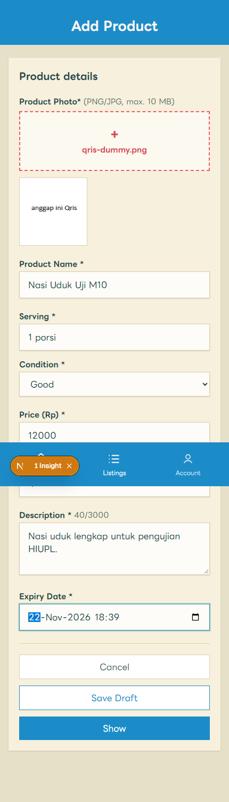  |
| UC01-TC02 | 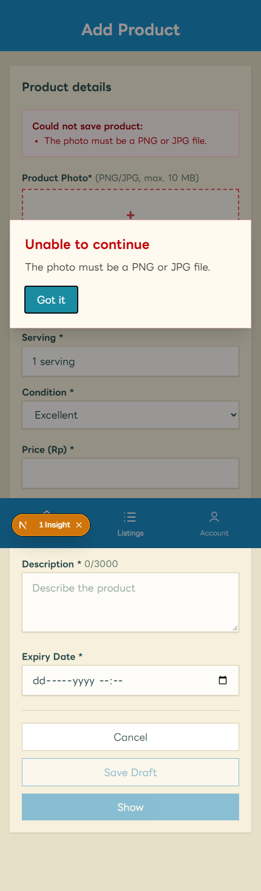 |
| UC01-TC03 | 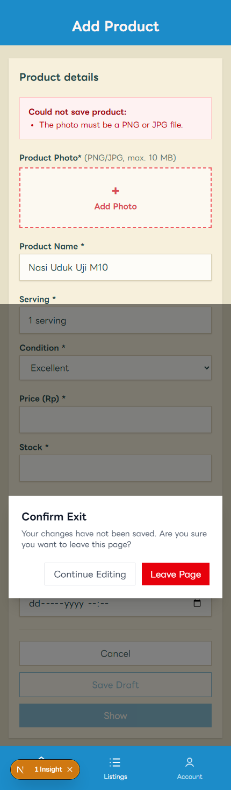 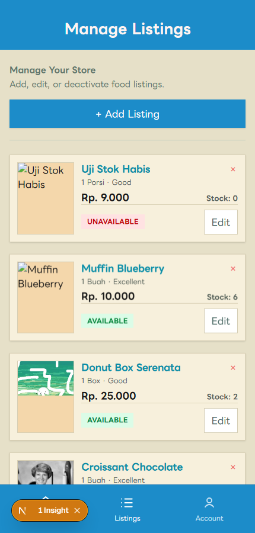 |
| UC02-TC01, UC07-TC01 | 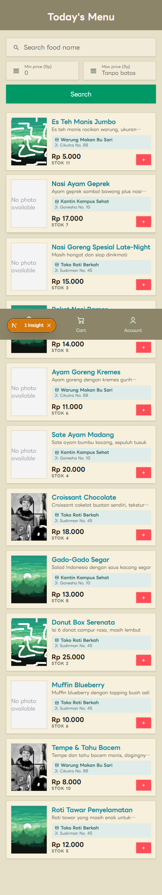 |
| UC02-TC02 | 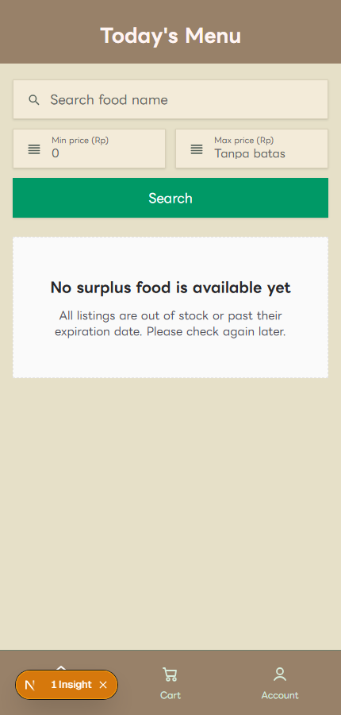 |
| UC02-TC03 | 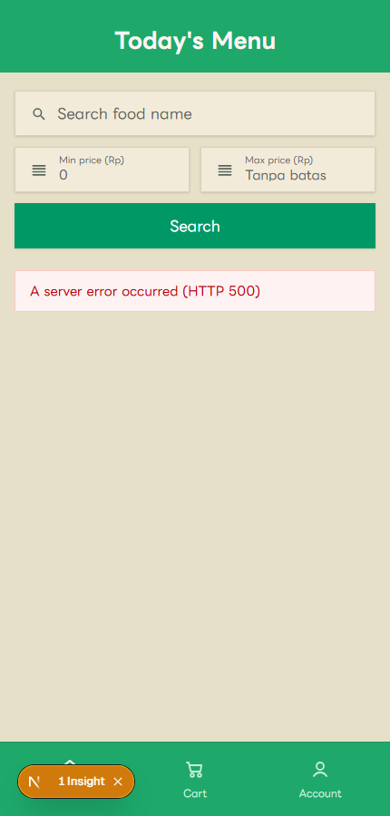 |
| UC03-TC01 | 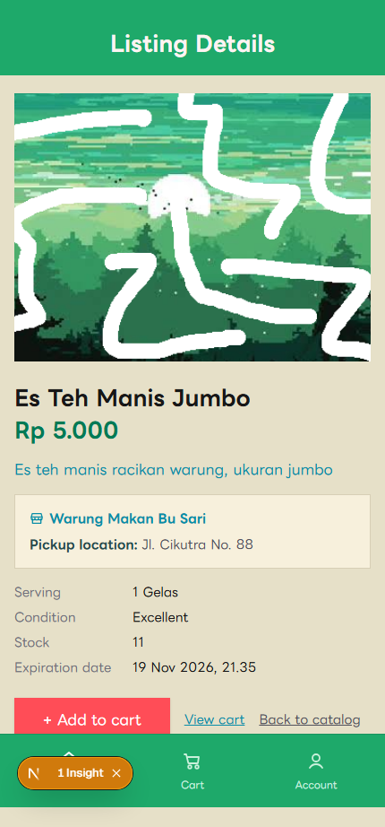 |
| UC03-TC02 | 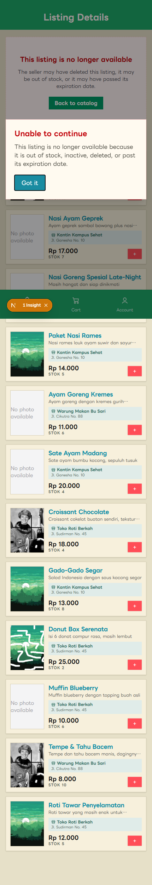 |
| UC04-TC01 | 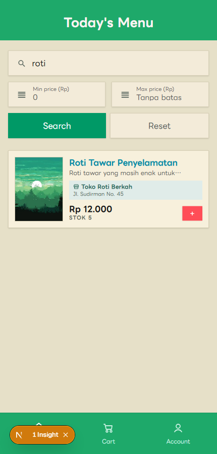 |
| UC04-TC02 | 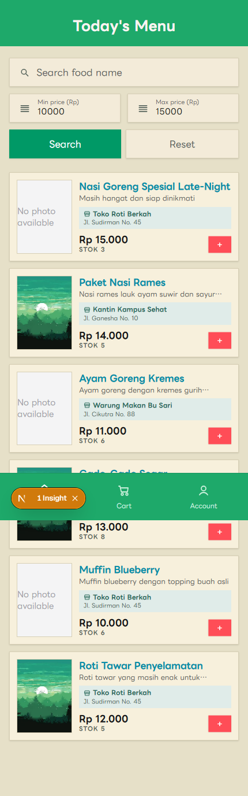 |
| UC04-TC03 | 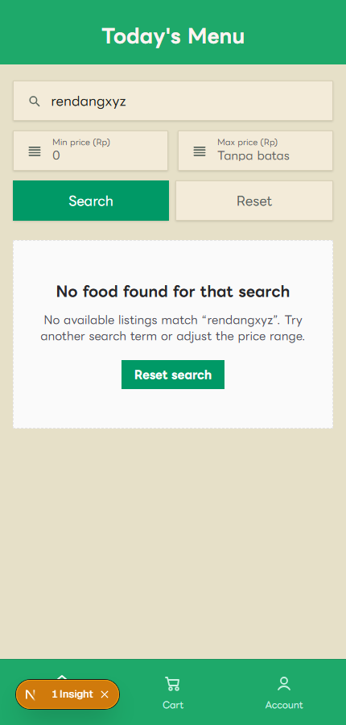 |
| UC04-TC04 |  |
| UC05-TC01 | 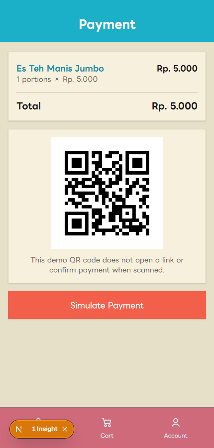 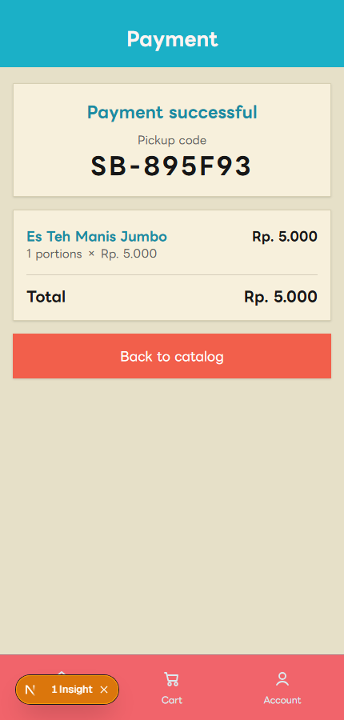 |
| UC05-TC02 | 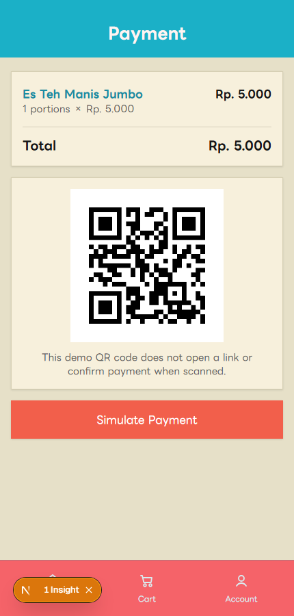 |
| UC06-TC01 | 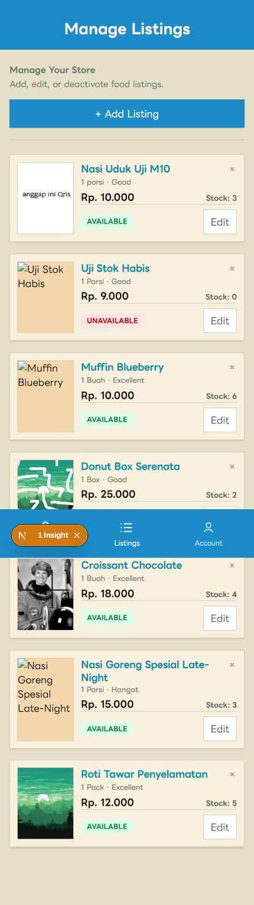 |
| UC06-TC02 | 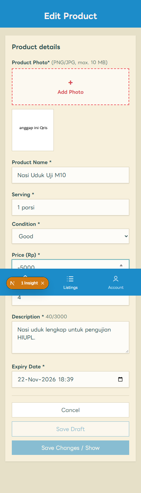 |
| UC07-TC02 | 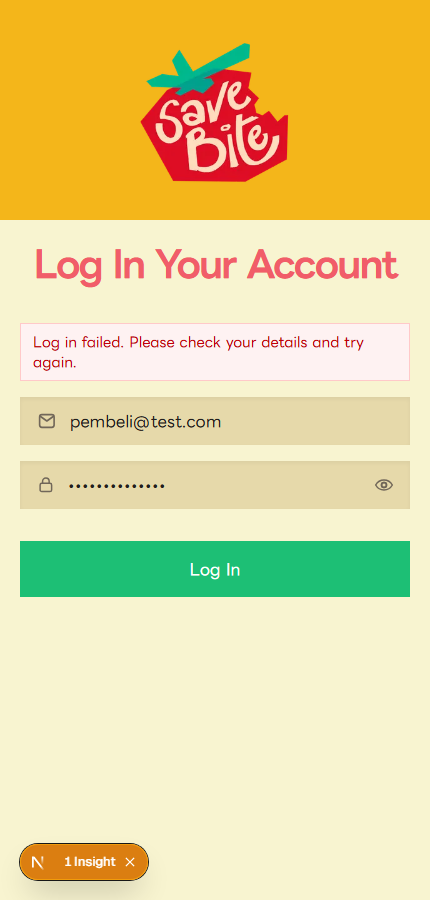 |
| UC08-TC01 | 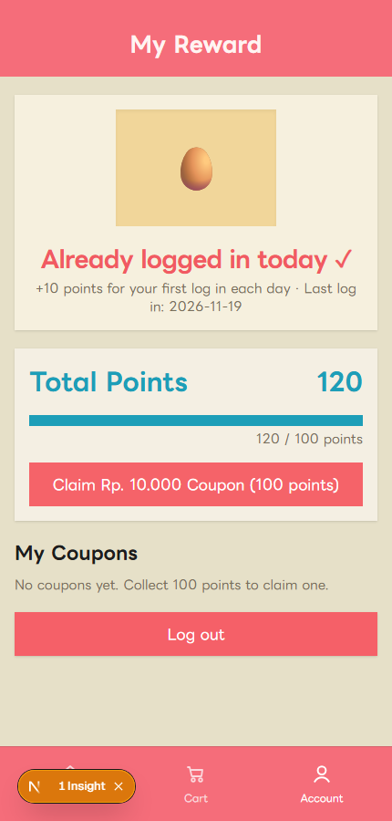 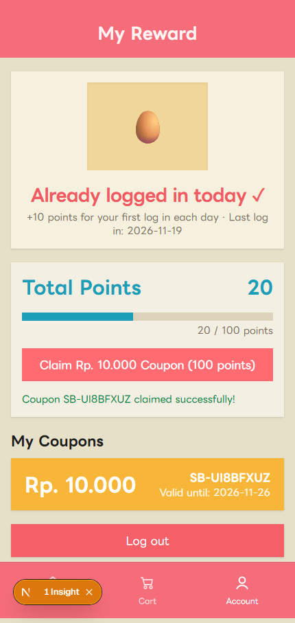 |
| UC08-TC02 | 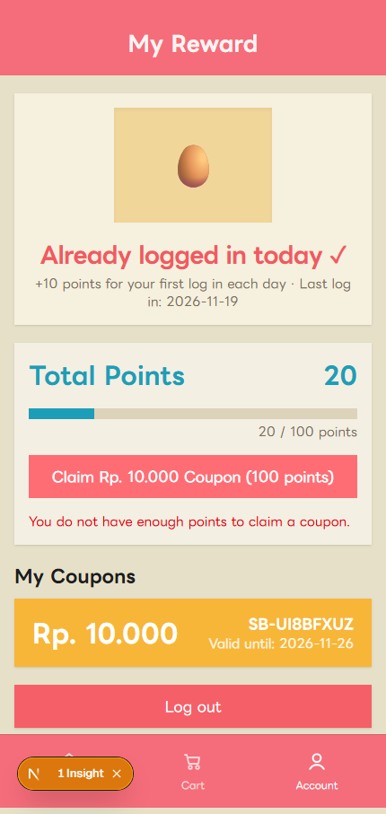 |
| UC09-TC01 | 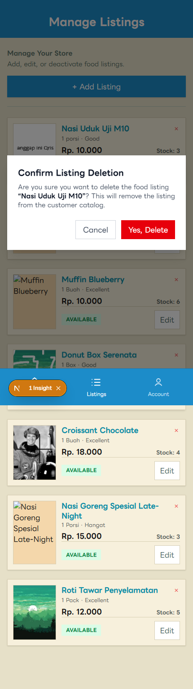 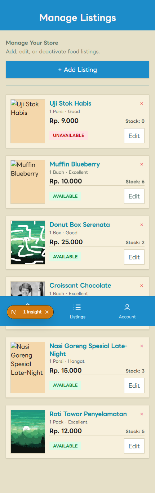 |
| UC09-TC02 | 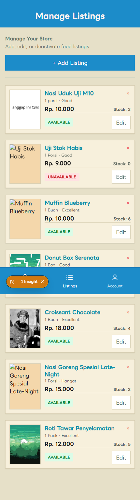 |
| KNF01-TC01 – KNF01-TC03 | [pytest-backend.txt](./assets/bukti/pytest-backend.txt): `test_rollback_menyeluruh_bila_satu_item_gagal`, `test_stok_terakhir_berebut_hanya_satu_berhasil`, `test_e2e_bayar_ganda_idempoten` PASSED |
| KNF02-TC01, KNF02-TC02 | [knf02-inspeksi-db.txt](./assets/bukti/knf02-inspeksi-db.txt) |

<br>

---

# BAB 5: Traceability

Setiap KF dipetakan ke KNF, use case, kelas perancangan, file implementasi, dan test case. Sebuah KF dinyatakan terpenuhi apabila **seluruh** test case terkaitnya berkesimpulan `Pass`.

Tabel 5.1. Matriks Kerunutan KF terhadap Implementasi dan Pengujian

| KF ID | KNF Terkait | Use Case ID | Kelas Terkait | Implementasi File Terkait | Test Case (UC) | Test Case (Unit/Integrasi/KNF) | Status |
| :--- | :--- | :--- | :--- | :--- | :--- | :--- | :--- |
| KF01 | - | UC01 | C04 - ListingMakanan<br>C12 - ListingView<br>C17 - ListingController<br>C20 - Validasi | `src/backend/api/listing_routes.py`<br>`src/backend/services/listing_service.py`<br>`src/backend/validation.py`<br>`src/frontend/app/penjual/listing/tambah/page.tsx` | UC01-TC01, UC01-TC02, UC01-TC03 | C04-UT01, C17-UT01 s.d. C17-UT06, C17-UT10 s.d. C17-UT12, C20-UT01 s.d. C20-UT07, C12-UT01, C12-UT02, INT-TC03, INT-TC05 | Terpenuhi |
| KF02 | - | UC02<br>UC03<br>UC09 | C04 - ListingMakanan<br>C11 - KatalogView<br>C12 - ListingView<br>C16 - KatalogController<br>C17 - ListingController | `src/backend/controllers/katalog_controller.py`<br>`src/backend/models.py`<br>`src/backend/api/listing_routes.py`<br>`src/frontend/app/katalog/`<br>`src/frontend/app/penjual/listing/page.tsx` | UC02-TC01 s.d. UC02-TC03, UC03-TC01, UC03-TC02, UC09-TC01, UC09-TC02 | C04-UT01 s.d. C04-UT06, C16-UT01 s.d. C16-UT04, C17-UT07, C17-UT09, C11-UT01, INT-TC01, INT-TC02, INT-TC04 | **Belum terpenuhi** (UC02-TC03 Fail: opsi muat ulang belum ada) |
| KF03 | - | UC04 | C04 - ListingMakanan<br>C11 - KatalogView<br>C16 - KatalogController | `src/backend/controllers/katalog_controller.py`<br>`src/backend/models.py` (`cariDaftar`)<br>`src/frontend/components/katalog/` | UC04-TC01 s.d. UC04-TC04 | C04-UT07, C16-UT05 s.d. C16-UT09, INT-TC01 | Terpenuhi |
| KF04 | KNF01 | UC05 | C05 - MetodePembayaran<br>C06 - Transaksi<br>C08 - ItemTransaksi<br>C09 - Kupon<br>C13 - PembayaranView<br>C18 - PembayaranController<br>C21 - PaymentGatewayAdapter | `src/backend/controllers/pembayaran_controller.py`<br>`src/backend/api/pembayaran_routes.py`<br>`src/backend/adapters/`<br>`src/frontend/app/cart/page.tsx`<br>`src/frontend/app/pembayaran/[idTransaksi]/page.tsx` | UC05-TC01, UC05-TC02 | C06-UT01 s.d. C06-UT07, C08-UT01 s.d. C08-UT03, C09-UT01 s.d. C09-UT08, C18-UT01 s.d. C18-UT13, C21-UT01 s.d. C21-UT03, C13-UT01, C13-UT02, INT-TC08 s.d. INT-TC11, KNF01-TC01 s.d. KNF01-TC03 | **Belum terpenuhi** (UC05-TC02 Fail: pembatalan saat keluar belum diimplementasikan; KNF01-TC04 belum diuji) |
| KF05 | - | UC06 | C04 - ListingMakanan<br>C12 - ListingView<br>C17 - ListingController<br>C20 - Validasi | `src/backend/api/listing_routes.py` (`ubah_listing`)<br>`src/backend/validation.py`<br>`src/frontend/app/penjual/listing/[id]/edit/page.tsx` | UC06-TC01, UC06-TC02 | C17-UT07, C17-UT08, C20-UT02 s.d. C20-UT04, INT-TC04 | Terpenuhi |
| KF06 | KNF02 | UC07<br>UC08 | C01 - Pengguna<br>C07 - RewardLogin<br>C09 - Kupon<br>C10 - LoginView<br>C14 - RewardView<br>C15 - AuthController<br>C19 - RewardController | `src/backend/routers/auth.py`<br>`src/backend/controllers/reward_controller.py`<br>`src/backend/models.py`<br>`src/frontend/app/login/page.tsx`<br>`src/frontend/app/reward/page.tsx` | UC07-TC01, UC07-TC02, UC08-TC01, UC08-TC02 | C07-UT01 s.d. C07-UT07, C09-UT09, C15-UT01 s.d. C15-UT06, C19-UT01 s.d. C19-UT05, C10-UT01, C10-UT02, C14-UT01, C14-UT02, INT-TC06, INT-TC07, INT-TC12, KNF02-TC01, KNF02-TC02 | **Belum terpenuhi** (KNF02-TC02 Fail: SHA-256/HTTPS sebelum transmisi) |
| KF07 | KNF02 | UC01 s.d. UC04, UC06 s.d. UC09 | C20 - Validasi beserta kelas pemanggilnya | `src/backend/validation.py`<br>`src/backend/schemas/`<br>`src/backend/services/listing_service.py` | UC01-TC02, UC04-TC03, UC04-TC04, UC06-TC02, UC07-TC02, UC08-TC02 | C20-UT01 s.d. C20-UT08, C16-UT08, C17-UT05, C17-UT06, C17-UT11, C17-UT12, C18-UT04 | Terpenuhi |

Tabel 5.2. Matriks Kerunutan KNF terhadap Pengujian

| ID KNF | Parameter | KF/UC Terkait | Test Case | Status |
| :--- | :--- | :--- | :--- | :--- |
| KNF01 | Reliability | KF04 / UC05 | KNF01-TC01, KNF01-TC02, KNF01-TC03, KNF01-TC04; pendukung C18-UT11, C18-UT12, INT-TC09 | Terpenuhi: TC01–TC04 Pass |
| KNF02 | Security | KF06 / UC07, UC08 | KNF02-TC01, KNF02-TC02 | Sebagian: penyimpanan hash Pass; SHA-256/HTTPS sebelum transmisi Fail |

Ringkasan: dari 7 KF, **4 terpenuhi** (KF01, KF03, KF05, KF07) dan **3 belum terpenuhi** (KF02, KF04, KF06), masing-masing karena satu test case Fail yang perbaikannya tercantum pada Subbab 4.4 dan 4.5.
